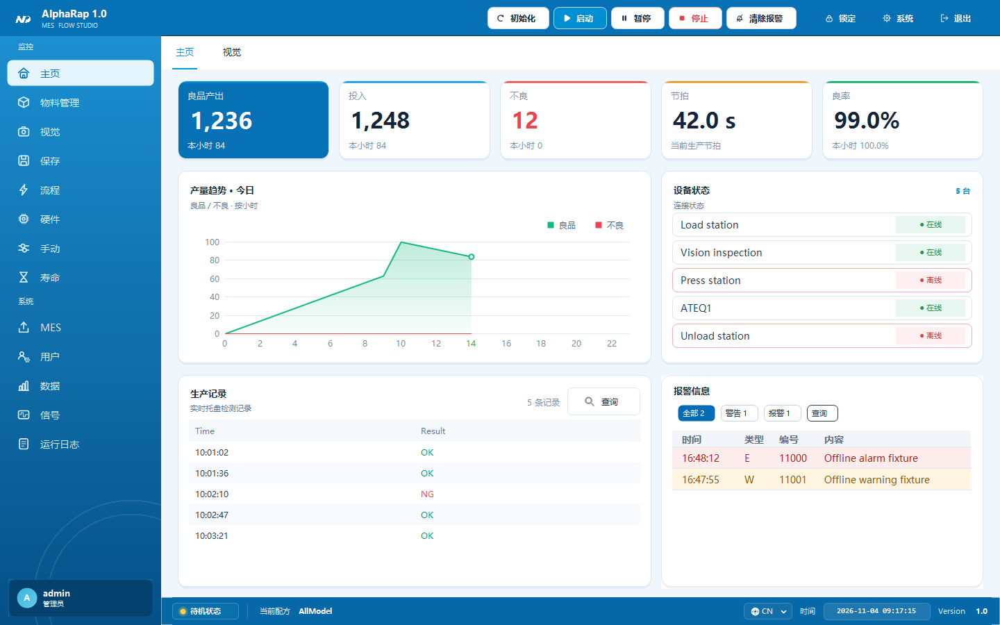

# AlphaRap 1.0 新手使用手册

从第一次登录到首件验证和现场排障
适用于操作员、维护人员和第一次接手 AlphaRap 1.0 的应用工程师。可以按岗位选读，也可以用同一套练习走完整个配置过程。

要在 C# 中实施二次开发，从[应用开发手册](AlphaRap%201.0%20应用开发手册.md)开始。

## 第一次使用从这里开始

> 从现场负责人取得当前工控机的程序目录、个人账号、正式型号、接线点表和一件已知结果的样品。先学会确认型号、看状态和查报警，再接触手动动作或修改参数。

## 目录

- [01 认识主界面](#01-认识主界面)
- [02 第一次开机和生产](#02-第一次开机和生产)
- [03 物料管理和保存](#03-物料管理和保存)
- [04 输入输出和气缸](#04-输入输出和气缸)
- [05 轴和配方点位](#05-轴和配方点位)
- [06 设备通信和常量](#06-设备通信和常量)
- [07 相机和 VPP 入门](#07-相机和-vpp-入门)
- [08 九点标定和旋转标定](#08-九点标定和旋转标定)
- [09 流程监视和故障定位](#09-流程监视和故障定位)
- [10 生产记录和运行日志](#10-生产记录和运行日志)
- [11 MES 用户和维护功能](#11-mes-用户和维护功能)
- [12 应用代码中怎样找资源](#12-应用代码中怎样找资源)
- [13 第一个 AlwaysRun 常驻任务](#13-第一个-alwaysrun-常驻任务)
- [14 在 AlwaysRun 里读 IO 和报警](#14-在-alwaysrun-里读-io-和报警)
- [15 周期读取设备范例](#15-周期读取设备范例)
- [16 常见问题按顺序排查](#16-常见问题按顺序排查)
- [17 备份交接和首次验收](#17-备份交接和首次验收)

## 一套练习贯穿整本手册

练习型号用 TRAIN_A，表示在验证环境中从已获准的型号复制出来的练习配方。使用一件已知结果的样品练习看图、写测试记录和查结果。SAMPLE-001、IB_MaterialLow、Cam_Check 和 InspectLog 都是示例名称。现场的接线地址、允许偏差、MES 参数与实际型号以项目资料为准。

## 01 认识主界面

程序标题和右下角显示 AlphaRap 1.0。左侧是功能入口，顶部控制整机，底栏显示设备状态、当前配方、语言与登录账号。



*图 1　AlphaRap 1.0 主页。界面中的计数、设备状态和报警为离线示例。*

- 想看产量、节拍、当前报警或设备在线情况，进入【主页】。生产记录和报警区各有【查询】入口。
- 想换型，进入【物料管理】。想调相机，进【视觉】。想查工站卡在哪一步，进【流程】。
- 想核对输入和手动输出，进入【手动】。想设轴与点位，进入【硬件】。设备通信参数在顶部【系统】里。
- 想查产品与保存模块，进入【数据】。想按时间查发生过什么，进入【运行日志】。
> 菜单呈灰色时，先看底栏显示的账号、角色和设备状态。权限由管理员配置。同一个按钮也可能因运行中、正在停止或正在保存而暂时不可用。

## 02 第一次开机和生产

### 开机顺序

1. 从现场指定的完整程序目录打开 AlphaRap.exe。等待加载结束，使用分配给自己的账号登录。
2. 在底栏核对当前配方，按工单确认产品、治具和现场条件。看首页【设备状态】和【报警信息】。
3. 确认操作者和设备处于允许动作的状态后，点击顶部【初始化】。初始化可能连接设备、回零或执行工站动作。
4. 等初始化完成后点击【启动】。首件完成后，用已知样品核对视觉结果、产品判定和生产记录。生产按现场首件确认要求放行。

### 四个常用控制按钮

- 【暂停】保留可继续的流程会话。条件恢复后可按【启动】继续。用设备反馈确认实际动作状态。
- 【停止】终止本轮流程并等待相关工作退出。显示「停止中」时，等设备和软件都完成停止，再重新初始化。
- 【清除报警】确认原因已经排除后使用。清除后由操作员按现场要求重新初始化或继续相应会话。
- 【退出】先停止自动运行，核对最后一件产品的记录和 MES 回执，再处理未保存修改并退出。

### 第一次排查报警

1. 在首页记录报警时间、编号、内容和工站。选【全部】可以同时看到信息、警告和错误。
2. 若看到 3025「设备运行条件异常」，看内容里的信号名。按接线资料核对急停、气源和安全就绪状态。
3. 处理原因后清除报警，再按提示恢复。反复跳出同一报警时，把时间、当前型号和发生前的操作一并交给维护人员。
> 急停、光栅等现场保护由设备安全回路承担。软件的运行许可用于状态检查、报警和协调停机。现场调试先遵循设备的操作授权与安全规程。

## 03 物料管理和保存

### 认识型号与配方

型号是界面中选中的产品名称。配方是运行这个型号时的一组参数，例如产品识别字段、配方常量和轴点位。相机的生产 VPP 也按当前配方加载对应文件。

### 范例 从现有型号建立练习配方

1. 在验证环境中停止设备，打开【物料管理】，选中已用于复制的型号并核对它是当前型号。
2. 确认列表里没有 TRAIN_A，填写新型号名称后点击【新建型号】。新建会复制当前型号的配方文件。同名会覆盖文件，练习使用未被占用的名称，创建后单独核对 VPP、限值及项目要求。
3. 在左侧选中 TRAIN_A，点击【使用选中型号】。核对页内「当前型号」与主界面底栏，确认已经切换。
4. 在需要修改的配方参数页填写练习值，点主界面左侧【保存】。重新打开页面核对，再切走并切回 TRAIN_A，确认它独有的值仍在。

### 修改能不能被下次启动读到

- IO、轴、Device、常量、日志模块与视觉草稿通常先在编辑窗口点【确定】或保留修改，再到主界面点【保存】。主保存成功后再验证。
- 保存提示中选择放弃会撤销相应未保存修改。想保留改动先读清对话框。保存失败时记下报错并核对原配置，修正后再保存。
- 账号、语言和报警表等窗口有各自的生效方式。报警表在【报警设定】窗口内保存，修改后重启确认当前运行表。
> 换型前先处理未保存的草稿。现场常见错误是把正在编辑的型号当成正在使用的型号，或已点【确定】但未点主【保存】。

## 04 输入输出和气缸

### 先读懂 IO 卡片

DI 是数字输入，例如感应器反馈。DO 是数字输出，例如指示灯控制。资源名称给代码调用，显示文字给操作人员看，物理地址由电气点表确定。气缸组合卡的 ON 或 OFF 会使用已绑定的输出资源。

### 范例 核对一条缺料输入

1. 用有权限的账号，在设备待机时打开【手动 → IO 资源】。选目标页签，再点【新增输入】。
2. 资源名称填 IB_MaterialLow，显示文字填「缺料感应器」。使用现场厂商与接线地址。板卡使用 IO 点号，PLC 输入使用对应该驱动的通信参数和点地址。
3. 核对地址后取消「地址待配置」，点【确定】和主【保存】。已有连接点修改驱动参数时，按提示保存并重启。
4. 新建一般输入供应用程序使用时，由对应工站逻辑或自定义任务声明需要连接的名称。本手册第 14 节演示如何登记。设备初始化后，观察灯随感应器变化并核对读值。

### 范例 配置已有气缸的手动组合

1. 先确认气缸使用的两个输出都已存在，各自有唯一名称并正确配置。正常运行前核对缸到位输入反馈。
2. 在 IO 资源页新增或属性编辑气缸组合，分别选择 ON 与 OFF 使用的输出。核对其绑定对象、气路和动作方向，再主保存。
3. 只在获准的手动调试状态下验证。需要确认行程完成时，查看实际反馈输入；界面开关显示的输出状态只是其中一项。
> 卡片一直灰或代码读到 null 时，先看是否待配置、是否主保存、是否要求重启，以及是否已经初始化。急停、气源和安全就绪严禁用试填地址来代替现场信号。

## 05 轴和配方点位

### 在硬件页识别已有轴

【硬件】页按轴显示参数、状态、手动调试和配方点位。初次接手时优先核对轴名、驱动、轴号、单位、软限位、回零方式和当前坐标。如果进入页面时软件请求暂停生产，先按现场规则处理当前工件。

### 范例 核对练习配方的取料点

1. 在底栏确认当前配方是练习型号，打开【硬件】，进入指定轴的页签。
2. 查看轴状态和当前位置。确认设备具备手动操作许可，由有权限人员按设备规程将机构移到经确认的取料位置。
3. 在点位表新增或修改对应行，使用当前位置采样或工程确认值，填写注释「练习取料点」。核对轴单位与坐标基准。
4. 主保存后重新加载当前配方，核对该点行及注释。再切换另一个练习配方，确认配方点位随型号加载。

### 参数与点位的区别

- 驱动厂商、轴号、基础参数属于机器配置。连接参数变更后按提示重启。
- 点位表属于当前配方。已有流程若按点位顺序访问，插入、删除或移动行都要和工程师核对。
- 状态灯、伺服、回零、点动、定距和往返等功能用于调试，执行前核对机构、速度、方向及操作权限。
> 初学者可以先在只读状态识别轴和点位。示教和设定使用经过确认的机型数据，手册中的「取料点」仅用于说明保存和核对过程。

## 06 设备通信和常量

### 范例 添加一台扫码设备

1. 从顶部进入【系统 → 参数设定】，点击【添加设备】。
2. 选择项目实际支持的设备类型。新页签代表一台设备，给它一个唯一的设备名，例如 KeyenceScann。
3. 按面板字段填写 IP 与端口，或串口号与波特率等参数。使用经过批准的测试条码和设备指令。
4. 在允许连接测试时点【打开连接】，核对页面状态和实际返回值。回到首页看设备状态，再主保存。
> 「在线」代表设备实例报告的连接状态。验证扫码、测量等功能时，以实际业务返回值和设备文档为准。

### 范例 设置一个型号专用的检测长度

1. 打开【系统 → 系统设定】中的设计器常量，核对底栏当前练习配方。
2. 选【Recipe】，点【新增】，键填 CheckLength，类型选 double，值填经工艺验证的长度，说明填写单位。练习可用 12.5 mm 作为示例。
3. 点【确定】，再主保存。之后可改值和说明，类型在新建时确定。bool 值从下拉框选 true 或 false。
4. 切换配方后重新核对值。需要全机共用的常量放在【Setting】，例如项目定义的工位标签。

### 给刚接手的应用工程师

int 用于整数，double 用于带小数的数值，bool 用于开关，string 用于文本。常量是配置数据，周期中的实时状态由任务或流程代码维护。

## 07 相机和 VPP 入门

相机负责取图，SN 是相机序列号。VPP 是视觉算法文件。TB 是 VisionPro 的 ToolBlock 编辑窗口，用于训练特征、调参数和试跑。

### 范例 做一个单目标定位

1. 在【物料管理】确认当前练习配方。进入【视觉】，选一个可用于验证的相机页，或通过【添加相机】建页。关联经过确认的相机 SN。
2. 在相机页添加 VPP，给它一个唯一名称，例如 LocatePart。调整取像曝光，检查零件是否清楚无遮挡。
3. 点【编辑 TB】，使用「普通定位（单目标）」模板。进 LocatePattern 训练目标，设置搜索区域、分数与角度范围。
4. 使用同一光照下的几张已知图像试跑。检查 Accepted、MatchCount、Score，以及 x、y、A。A 的单位为度，x/y 的单位按标定状态判断。
5. 退出 TB 并保留修改，再点主【保存】。重新打开当前配方的 VPP 核对训练结果。

### 准备在生产中使用

VPP 设置页的「生产定位」用于选择生产定位算法。绑定前确认相机 SN、当前配方 VPP、标准输出和该项目要求的补偿限制。自动生产前停止实时显示，退出 TB 编辑，取消离线图片输入并保存。

> 没发现目标时，先看是否取得图像，再查曝光、训练、搜索区域和阈值。拍照失败或匹配失败时，流程应查看本次成功状态后再使用坐标。

## 08 九点标定和旋转标定

### 九点标定怎样理解

九点标定把相机看到的位置与真实机械位置配成点对。完成后可把图像位置换算成设备坐标。

1. 核对配方、相机、标定高度和曝光。在相机页【添加标定】，选择「圆心」或「两线交点」。
2. 点【试拍】，通过【设置找边】让图形贴到已知标记上，再试拍验证特征识别。遇到失败先检查光照、搜索范围和特征边缘。
3. 保持 Z 和 R 一致，在视野内分散取样。到每个位置后，输入实际机械 X、Y，点【采集此点】。每次确认图像与输入坐标是同一次采集。
4. 有效点达到至少 9 个后点【应用九点】。查看拟合误差，用一个未参与标定的独立位置验收。只需要 XY 坐标换算时，此处即可主保存。

### 旋转标定需要九点有效

1. 同一相机同一配方的九点应用成功后，进入旋转标定。固定相机和 XYZ，只旋转吸嘴或工件 R 轴。
2. 始终选同一个偏离旋转中心的特征。每次输入实际 R 角度并采集，至少取得 3 组不同角度。
3. 点击【计算旋转中心】。检查机械中心、像素中心和拟合误差，再用独立角度复核。确认完成后主保存。
> 配方、相机或九点模型改变后，要重新确认旋转标定是否有效。机械中心的用法由工艺验证，输入坐标、中心和误差的单位须分别核对。

## 09 流程监视和故障定位

AlphaRap 1.0 的【流程】页显示已经编译的工站。应用程序中可看到 Gantry、UpConveyor、DownConveyor 等工站，初始化和自动步骤按现有程序执行。修改工艺步骤由开发人员修改对应 C# 代码并重新生成。

### 范例 输送线一直在等待传感器

1. 观测设备处于等待、暂停还是报警停机，记下当前配方、产品和发生时间。
2. 打开【流程】，找到对应工站与流程阶段，记录当前步骤标题和页面显示的错误。
3. 若步骤在等感应器，查看【手动 → IO 资源】相应 DI 状态。需要进入调试页时，先处理运行状态，因为切入手动或硬件会走暂停入口。
4. 回到【运行日志】以同一时间段筛选关键字。若怀疑设备通信，同时核对首页在线状态与实际测试返回值。
5. 把「型号、工站、步骤、信号名称、报警编号、时间」一起交给维护或开发。

### 交给开发人员时

- 上料、下料和视觉主工站代码在 AlphaRap 项目的 TaskProcess 下。用界面上的工站名和步骤标题定位。
- 自动运行的单件数据在同一产品周期传给后续步骤。对条码、视觉和测量值，按本件产品的结果处理。
- 将相同条件用一件已知结果的样品复现，再对照变化前后的日志。
> 「有运行状态但没有产出」常发生在等上游握手、等传感器或等视觉完成时。先找等待步骤，再查信号，通常比直接改参数更快。

## 10 生产记录和运行日志

### 常用查询入口

- 【主页 → 生产记录 → 查询】适合核对当前产量和最近产品结果；【数据】适合选择保存模块、日期与关键字查历史。
- 【运行日志】用于查程序步骤和错误。优先选「今天」，按报警时间缩小范围，再用设备名、工站名或编号搜索。
- 【主页 → 报警信息 → 查询】用于查报警历史。MES 回执与本地记录要按同一个产品编号核对。

### 范例 建立可在首页显示的生产日志

1. 打开【数据 → 日志模块 → 新增日志模块】，模块名填 InspectLog，目录填现场允许的写入目录。
2. 增加 Barcode（Text）、MeasureValue（Number）、Result（Text）三列。Time 由程序自动生成。
3. 勾选【用作首页生产记录】，点【确定】并主保存。首页最多绑定一个日志模块，选新的会替换当前绑定。
4. 在本件检测结束的 C# 流程步骤调用下方方法，传入真实条码、测量值与判定。写入成功后，可用 SAMPLE-001 在首页或【数据】查询。

```csharp
using System.Collections.Generic;

namespace AlphaRap
{
    internal static class InspectLogExample
    {
        /// <summary>在单件检测完成后保存一条记录。</summary>
        internal static string Save(string barcode, double value, bool passed)
        {
            return ApplicationHost.Data.WriteLogByName("InspectLog",
                new Dictionary<string, object>
                {
                    ["Barcode"] = barcode, ["MeasureValue"] = value,
                    ["Result"] = passed ? "OK" : "NG"
                });
        }
    }
}
```

> 保存接口每调用一次就追加一行。放在单件完工步骤，使用该产品的最终结果。按模块名称和字段键传值，应用中显示的翻译标题可独立维护。

## 11 MES 用户和维护功能

### MES 调试顺序

MES 用于和客户的生产系统交换数据。页面和接口按应用项目配置，现场需核对客户接口表。

1. 在【物料管理】核对当前型号、产品 ID、工序 ID、配方 ID 和实际用到的条码检查项。
2. 在【MES】确认测试环境的接口和参数，使用客户授权的测试条码做一次通信验证。
3. 核对请求对应的业务结果和回执。用同一个产品编号检查本地记录及 MES 记录，记录通信失败时间。
4. 超时或回执不明确时，先查该产品的服务端状态，再按客户重复提交规则处理。

### 用户与语言

- 点击左下角账号区打开登录。输入分配的账号密码；项目已安装和配置指纹模块时，可用已登记的指纹。
- 在【用户】由管理员管理用户和权限。菜单锁住时先核对权限、设备状态和待保存设置。
- 底栏语言选择可在中文、English 和 Español 间切换。IO、设备和日志字段的资源名称继续给代码使用，显示文字由语言配置决定。

### 其他维护入口

- 【信号】用于查看和设定各设备状态下的灯塔和蜂鸣器，例如待机或运行时红、黄、绿灯是熄灭、常亮还是闪烁。按机台规定核对并记录调整。
- 【寿命】用于管理项目配置的耗材和部件使用记录。更换后按现场维护规定登记，再执行相应复位。
- 顶部【系统】还可以进入平台、参数、语言和报警设定。报警设定中类型 E 在首页【报警】筛选显示，信息与警告可在【全部】查询。

### 范例 配置一个普通提醒

在验证环境进入【系统 → 报警设定】，用未占用的编号新增 A9101，类型选 W，停机标志选 False，填写三语提示「缺料提醒」。保存并重启后，应用代码在检测到缺料时可调用 NPSDK.Alarm.Show("9101")，打开首页【全部】或【警告】查看。

## 12 应用代码中怎样找资源

先核对界面保存的唯一资源名称，再在 C# 使用下列入口。括号里的名称来自实际配置，使用该对象前确认已具备操作权限和驱动条件。

- 输入与输出用 ApplicationHost.GetInput("IB_MaterialLow") 和 ApplicationHost.GetOutput("OB_Indicator")。常驻任务读输入优先使用 context.ReadInput(...)。
- 轴用 ApplicationHost.GetAxis("X1")。要读取当前配方已保存的点位，用 ApplicationHost.GetAxisPoints("X1")，P1 对应索引 0。
- 气缸用 ApplicationHost.GetCylinder("StopCylinder")。先确认两路输出绑定、连接状态和实际动作权限。
- 设备用 ApplicationHost.GetDevice<T>("KeyenceScann")。T 填工程里绑定的实际设备类型。先看连接状态，再按驱动接口执行读写。
- 相机配置用 ApplicationHost.GetCamera("Cam_Check")。算法工位用 ApplicationHost.GetVpp("Cam_Check", "LocatePart")，并核对当前型号及本次运行结果。
- 常量用 ApplicationHost.GetConstant<double>("Recipe", "CheckLength")。机器级使用 "Setting"，泛型类型要和常量定义一致。
- 生产日志用 ApplicationHost.Data.WriteLogByName(...)，模块和字段都使用已保存的名称。

### 读不到时先检查什么

- 代码名称必须能对应已保存的资源。Name 与 Text 的用途不同，显示文字修改后代码仍用资源名称。
- 先查配置是否有草稿、地址是否待配置、驱动是否初始化、实际设备是否可通信。相机和配方常量再核对当前配方。
- 读取 DI 时保留 true、false、null 三种结果。驱动错误或未就绪应进入不可用分支，后续流程再按机台规则处理。

## 13 第一个 AlwaysRun 常驻任务

需要每隔一段时间观察状态、查询设备或执行维护逻辑时，在 AlphaRap 应用项目中实现 IAlwaysRunTask。每类负责一件事，例如缺料监视、通信心跳或定时状态记录。

### 范例 验证任务能自动进入刷新

1. 在 Visual Studio 打开 AlphaRap1.0.sln，在 AlphaRap 项目的 Tasks 文件夹右键【添加 → 类】，命名为 TimerExample.cs。
2. 将类内容替换为下方代码，构建 Debug x64。在验证环境运行软件，确认当前环境允许执行真机模式下的应用任务。本例没有硬件输入或输出。
3. 打开 Visual Studio 的【输出 → 调试】或在 RefreshAsync 打断点，确认每轮执行能观察到消息。

```csharp
using System;
using System.Diagnostics;
using System.Threading;
using System.Threading.Tasks;

namespace AlphaRap
{
    internal sealed class TimerExample : IAlwaysRunTask
    {
        public int IntervalMs => 1000;
        public string[] InputNames => Array.Empty<string>();

        /// <summary>验证应用定时刷新入口。</summary>
        public Task RefreshAsync(AlwaysRunContext context, CancellationToken token)
        {
            Debug.WriteLine("TimerExample 正在刷新");
            return Task.CompletedTask;
        }
    }
}
```


### 一个任务怎样运行

启动时创建带无参数构造函数的具体类，实例字段跨轮保留。完成一轮后等 IntervalMs 再执行下一轮，两个任务各自执行。仿真模式跳过应用常驻任务。关闭时会通知取消，并等待当前轮退出。异步调用应等待实际结果，同时把 token 传给支持取消的接口。

## 14 在 AlwaysRun 里读 IO 和报警

### 范例 只在缺料状态变化时记录

先在【手动 → IO 资源】配置并保存 IB_MaterialLow。新建 MaterialLowMonitor.cs，填如下内容。整机初始化会为已声明的输入连接驱动。第一次读到有效值后，状态变化才写日志。

```csharp
using System.Threading;
using System.Threading.Tasks;

namespace AlphaRap
{
    internal sealed class MaterialLowMonitor : IAlwaysRunTask
    {
        private const string Name = "IB_MaterialLow";
        private bool? lastState;
        public int IntervalMs => 250;
        public string[] InputNames => new[] { Name };

        /// <summary>记录缺料、恢复和读取失效。</summary>
        public Task RefreshAsync(AlwaysRunContext context, CancellationToken token)
        {
            bool? state = context.ReadInput(Name);
            if (lastState == state) return Task.CompletedTask;

            if (!state.HasValue)
                ApplicationHost.Data?.AddLogError("缺料输入无法读取");
            else
                ApplicationHost.Data?.AddRunLog(state.Value ? "检测到缺料" : "料位正常");

            lastState = state;
            return Task.CompletedTask;
        }
    }
}
```


### 判断电平和运行许可

true 表示按配置处理后的有效状态。若实际低电平为有效，核对后在 IO 属性勾选「反转有效电平」。普通提示、定时统计和通信记录都在各自的 RefreshAsync 实现。
整机运行许可在 AlwaysRunTask() 中通过 WatchInput("IB_SafetyReady", requiredForRun: true) 登记。异常或读不到会在许可检查中报告 3025，运行中请求整机停止。新安全信号按项目电气设计接入并验证。

> 必须在明确允许的软件调试状态下打断点。WatchInput 登记只在启动创建对象时执行，观察实时值要把断点打在 ScanSafety 或自己的 RefreshAsync。

## 15 周期读取设备范例

### 范例 读取已连接的汇川 PLC

当项目已经使用 INOVANCE 且工站负责建立零号连接时，可以写一个独立任务查看诊断寄存器。此例只读。先从现场 PLC 点表取得可读诊断地址。D100 只是代码示例，字数和数据类型也按点表确认。

```csharp
using System;
using System.Threading;
using System.Threading.Tasks;
using AlphaRap.PLC;

namespace AlphaRap
{
    internal sealed class PlcReadMonitor : IAlwaysRunTask
    {
        private readonly INOVANCE plc = new INOVANCE();
        private PlcStatus? previousStatus;

        public int IntervalMs => 1000;
        public string[] InputNames => Array.Empty<string>();

        /// <summary>读取诊断地址并记录通信状态变化。</summary>
        public Task RefreshAsync(AlwaysRunContext context, CancellationToken token)
        {
            PlcResult<string> reply = plc.ReadPlcResult(
                "D100", 1, timeoutMs: 500, token: token);
            token.ThrowIfCancellationRequested();

            if (previousStatus == reply.Status) return Task.CompletedTask;
            if (reply.Succeeded)
                ApplicationHost.Data?.AddRunLog("PLC 诊断读取正常，值 " + reply.Value);
            else
                ApplicationHost.Data?.AddLogError(reply.Message);

            previousStatus = reply.Status;
            return Task.CompletedTask;
        }
    }
}
```

当状态为 NotConnected、Timeout 或 DriverError 时，从【运行日志】查看对应记录。读取成功后，才可以使用本次 Value。项目有其他设备类型时，使用该类型实际提供的接口、超时和取消方式。

> 心跳信号的地址、变化含义和失效时间由 PLC 协议定义。这个范例确认诊断读取和日志链路，具体心跳判定应使用项目协议。

## 16 常见问题按顺序排查

### 点了启动没有动作

确认是否仍在停止或保存，是否已成功初始化，当前账号是否能操作，是否有未处理报警。再核对当前配方、工站等待步骤和设备状态。

### AlwaysRun 一直读到 null

检查资源名称、厂家驱动、实际地址、地址待配置、是否主保存与重启、是否已初始化及真实通信。自定义任务的 InputNames 里应包含该资源名。四个许可点同时为 null 时，先看它们是否还是模板里的待配置点。

### 断点没命中

构造函数只在启动创建对象时执行一次。启动后查周期逻辑，去 RefreshAsync 或 ScanSafety 处。若仍未命中，核对 Debug x64、启动项目、实际运行的 AlphaRap.exe、调试符号、仿真状态和当前文件是否已包含到项目中。

### 相机画面空或 VPP 有 NG

按 SN、连接、图像、曝光、训练特征、搜索范围的顺序检查。当前配方应加载对应 VPP。始终核对本次运行状态和结果，避免使用上一件的坐标。

### 首页没有新生产记录

确认产品是否已执行到完工保存接口，模块名与字段是否匹配，文件是否写入成功。检查已保存的首页绑定、日期筛选以及正式和仿真目录。

### 改了值但重新打开恢复旧值

先检查修改是否提交到编辑草稿，以及是否点主【保存】并成功。再核对当前配方、要运行的程序目录和机器配置目录，避免编辑了另一份工程。

> 交接问题时带上型号、品号或条码、准确时间、账号权限、报警编号、工站步骤，以及出错前最后一次成功操作。

## 17 备份交接和首次验收

### 备份一台已在使用的设备

1. 撤出生产并按现场要求停机，完成正在写入的任务，核对已保存配置。
2. 保留完整程序与运行目录，以及 MachineSetup.ini 指向的实际数据目录。重点核对机器设置、配方、VisionData、语言和报警表、密码权限数据库和日志路径。
3. 拷贝到独立验证目录进行恢复核对。对每台机器分别保留配套驱动、配方、相机 SN 和 IO 点表。实际地址来自本机现场资料。
4. 核对版本、当前配方、IO 名称和地址、轴点位、相机与 VPP、MES 设置、日志目录及账号权限。确认恢复后再安排实机验证。

### 第一次验收清单

- 已用个人账号登录并能确认当前型号与软件版本。
- 已在练习环境完成一次型号复制、修改、主保存、切换与复查。
- 能通过界面看一条 IO 的变化、看相机照片和当次检测结果。
- 能找到本件生产记录、报警历史和运行日志，知道它们各自回答什么问题。
- 若新增了常驻任务，已验证正常、异常、不可用和恢复的表现，以及退出时能结束。
- 已由现场负责人确认真机方向、限位、运行许可、急停保护、视觉精度和客户接口。

### 工程资料索引

工程 docs 目录中可继续阅读 [HardwareResources.md](HardwareResources.md)、[VisionBuiltInAlgorithms.md](VisionBuiltInAlgorithms.md)、[RuntimeLogs.md](RuntimeLogs.md) 与 [MachineRunControl.md](MachineRunControl.md)。自定义常驻任务从 AlphaRap 项目的 [IAlwaysRunTask.cs](../AlphaRap/Tasks/IAlwaysRunTask.cs) 入手。现场接线表、工艺验收限值和客户协议按项目交付资料查阅。
