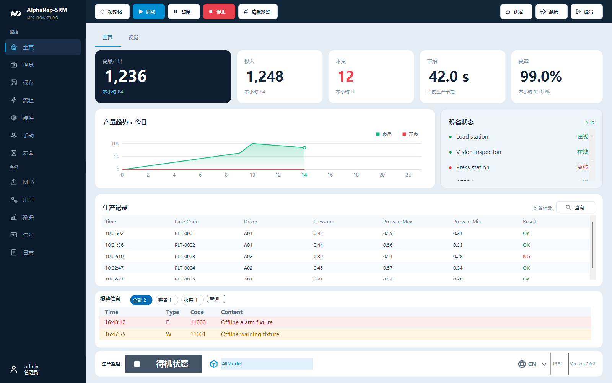
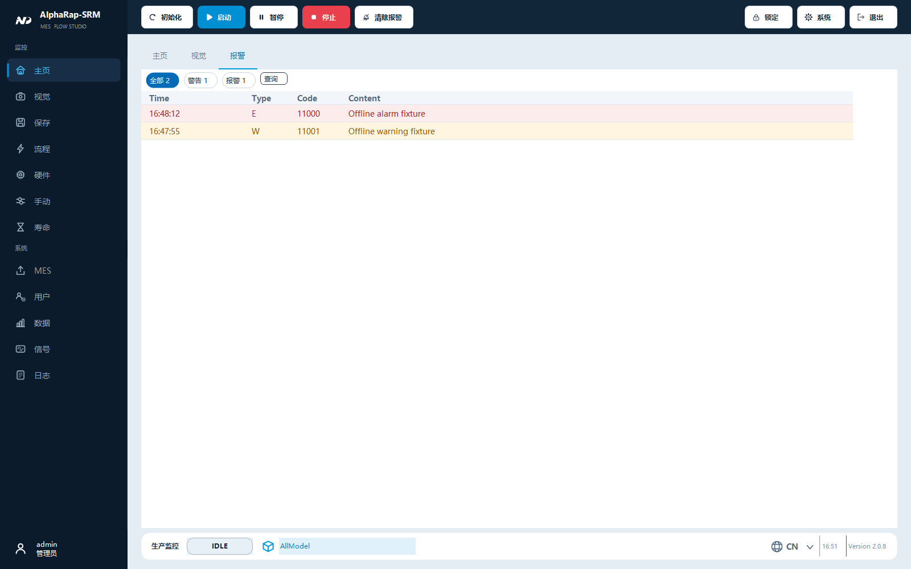
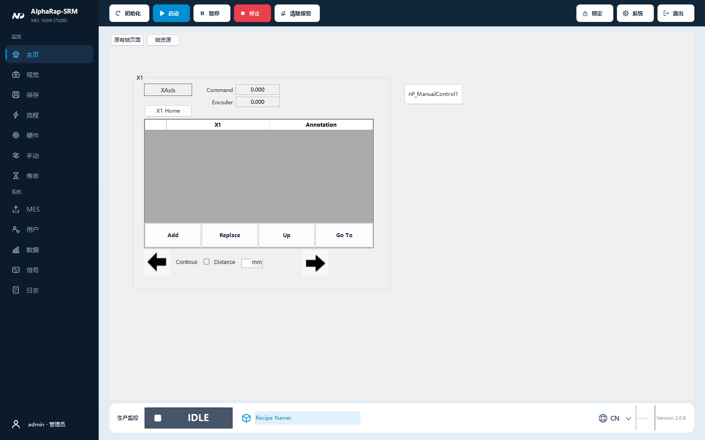

# 主界面使用与维护

主框架采用深蓝导航、顶部设备操作和浅灰卡片看板。默认窗口为 1600×1000，最小为 1280×800。

以下为离线测试实例，数值和设备名称为测试样本：





## 操作位置

- 顶部：初始化、启动、暂停、停止、清除报警；右侧为锁定、系统和退出。沿用原设备操作与权限判断。
- 左侧：主页、视觉、保存、流程、硬件、手动、寿命、MES、用户、数据、信号、日志。保存仍进入 MainForm 的统一配置保存事务。
- 首页：良品产出、投入、不良、节拍、良率；下方为今日产量趋势、设备连接状态和生产记录。
- 底部：设备状态、当前配方、软键盘、语言与版本。配方图标仍打开 ProductManagerForm。
- 首页下方常驻报警表：原报警表格、全部/警告/报警筛选和历史查询直接显示。点击底部设备状态会返回首页并聚焦报警表。

## 整机状态牌

底部整机状态采用最小 200×48 像素的色块、16pt 粗体文字及 32 像素图标，长状态文案自动加宽，最多占用 360 像素（均为 96 DPI 设计尺寸）。底栏预留相应高度，避免与配方和语言入口重叠。

待机使用灰蓝底和方形图标，初始化使用蓝底和回转箭头，运行使用绿底和运行三角，暂停使用黄底和双竖线，报警使用红底白字和警示三角。E 类报警优先于运行模式显示，报警条数、悬停详情和点击返回首页的行为沿用原入口。文案仍使用现有中英西语言包；此显示样式无需额外保存配置。

以下是离线报警状态示例：


## 数据含义

统计卡使用原生产累计数量与节拍，本小时数量放在卡片副文案中。第五张卡显示已有数据可计算的良率；目标产量和稼动率需要独立的业务数据来源。

趋势图使用当前日期的逐小时良品与不良数量，绿色面积线表示良品，红线表示不良。当前小时之后的区域留空。设备列表使用现有设备配置及连接状态，显示在线/离线，不把连接状态当作工位运行状态。

生产记录继续使用现有字段定义及本地生产数据存储。设备名称、配方名称、业务字段和记录值保持原值；界面标题、提示与状态支持中文、英文和西班牙文。配方切换、Setting/Recipe 作用域和 MainForm Save 的配置入口沿用原机制。

## 报警保留范围

原 `WarnningMessage` 控件常驻首页下方，报警编号、时间、类型、内容、筛选、历史查询及报警处理接口继续使用。切换首页和视觉页签时报警表仍可见。小窗口的上方看板可以滚动，报警表保持可见。报警主表仍位于原 AlarmTable 目录，中文主表的类型和停机规则、各语言报警内容的读取方式不变。

## 字体与文字可读性

主窗体的默认字体使用微软雅黑 10pt，默认文字为深色。嵌入页面和动态控件继承这一文字颜色；深色导航、品牌区和操作按钮继续使用各自的文字配色。修复了原主窗体白色文字向轴、IO 等浅色页面继承，导致按钮、标签看似没有文字的问题。

轴页面增大点位表的字体，保留旧 SDK 点动选项的原字体与尺寸；同时调整右侧点动箭头位置，防止被选项控件遮挡。以下为未加载机器参数的离线硬件页面：



## 开发位置与验证

`MainForm.Designer.cs` 维护固定框架布局，`MainForm.Frame.cs` 维护按钮绘制与状态样式。首页对应 `MenuForm/HomeForm` 三个 partial 文件，趋势图为 `Controls/HourlyChart.cs`。

使用 Visual Studio 2026 的 64 位 MSBuild 编译 Debug/x64，可避免 32 位 MSBuild 无法派生 x64 资源任务宿主的问题。

```powershell
./tests/MainDashboard/Run.ps1 -AssemblyDirectory '.vp-validation/dashboard-redesign-build/bin'
```

布局探针在设计模式构造实际窗体，解绑机器 Load 入口后显示测试窗口，检查三种语言、三个窗口尺寸、原操作事件、指标刷新和空数据，并生成截图。截图里的生产数据和设备清单属于离线测试样本。设备初始化、真实运动、IO 输出和相机采集仍需现场验证。

文字巡检将 42 个应用页面及可无参创建的流程、配置编辑控件放入实际主框架，检查 579 个文本控件的浅底浅字和过小的交互字体。该检查覆盖仓库中可离线构造的页面；外部 VPP 编辑器及按现场配置创建的第三方控件仍应在实际运行时核对。

状态牌验证覆盖待机、初始化中、初始化完成、运行、暂停及带条数报警的三语显示，检查文字完整性、底栏重叠和点击事件。离线渲染直接调用显示方法，不触发真实报警或设备状态切换。

本次状态牌交付的主界面回归为 10/10。当前工作区的设计器兼容检查为 14/15：工程文件将 `FlowDataMethods.cs` 业务类标记为独立窗体；使用修改前的程序集复核也出现相同失败。其余设计器检查通过，本次未修改该工程元数据。
