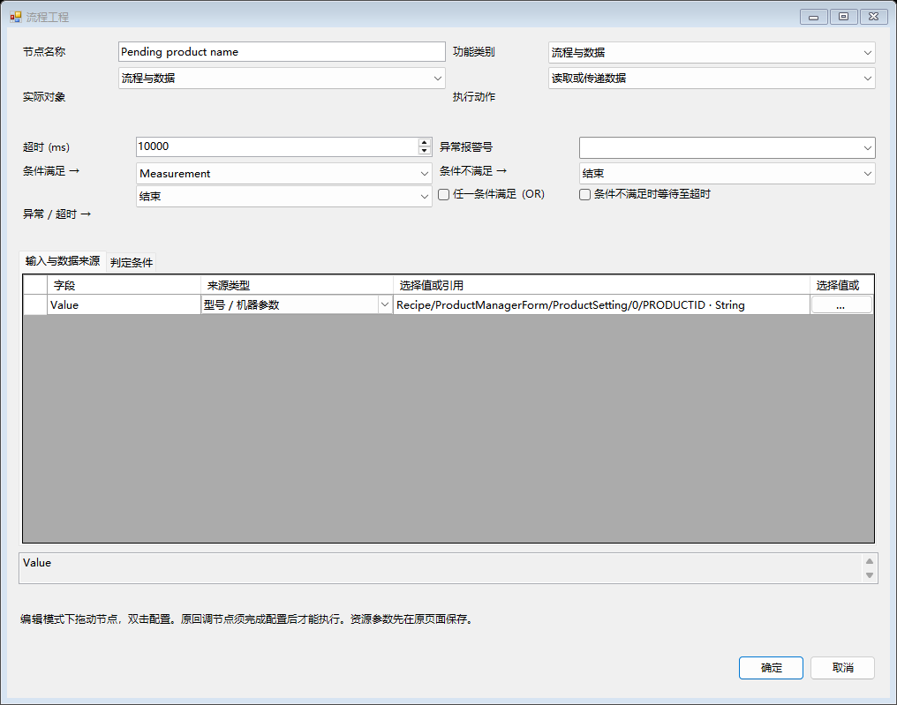

# Flow_BaseForm 节点设计器测试版

## 从哪里打开

正常生成并运行 `AlphaRap/bin/x64/Debug/AlphaRap.exe`，登录维护员或管理员账号，机器处于 IDLE，进入主界面的【流程】页。

接入点是 NPSDK 的 Flow_BaseForm 基类和 Flow_Module 生命周期。所有已经注册的派生窗体都会出现在页面里，后续新增派生窗体也自动接入，没有三个工位的白名单。保留窗体原有的初始化页、自动页和节点容器。也可直接【添加流程模块】，创建无需编写 Form 类的流程模块。

旧业务回调不会被猜测转换为设备动作。现有节点第一次导入时保留布局和连接，双击后由工程师明确配置实际动作；默认【保留原流程】允许逐步迁移。配置模式的可达路径中有未配置旧节点时，校验会明确拒绝运行。

## 配方只有 ProductManagerForm 一个入口

型号的创建、修改、使用、切换继续在 ProductManagerForm（物料管理）完成。流程设计器不增加另一套配方选择或配方存储。

节点的【型号 / 机器参数】直接列出模块现有 RecipeData / SettingData 的已保存字段，包括 ProductManagerForm 的 ProductSetting。点位来自 HardForm 等页面已有点位表与 ParameterSet 的轴关联；视觉使用 VPForm 当前配方已经加载的 VPP。

先在原页面修改并保存参数、点位、设备和 VPP，再测试流程。每次启动建立当前配方名、已提交参数及点位快照；运行中禁止切换配方或保存参数。下一次启动自然使用 ProductManagerForm 新加载的配方。生产记录中的 ModelName 由框架自动填写。未保存的页面编辑值不会进入运行快照。

## 配置一个节点

1. 选择流程模块，勾选【编辑流程】。在当前初始化页、自动页或现有画布中【添加节点】，拖动节点调整位置，双击打开配置。
2. 选【功能类别】→【实际对象】→【执行动作】。对象目录读取当前程序已有实例，不为浏览目录创建或连接设备。
3. 输入字段可以使用固定值、型号 / 机器参数、其他节点输出、当前产品上下文。点位动作的 Index 点选按钮会列出 `P1 [0]`、`P2 [1]` 等实际索引；Offset 必须由工程师明确绑定，框架不自动叠加视觉补偿。
4. 在【判定条件】增加条件。左、右来源均可选择；【当前动作结果】用于判断本次返回值，【其他节点输出】按模块 / 节点 / 字段选择。默认多个条件 AND，可勾选 OR。
5. 选条件满足、条件不满足、异常 / 超时三个出口；【结束】表示本模块本次执行结束。勾选【条件不满足时等待至超时】时，只轮询条件，不重复发送当前设备动作。
6. 设置超时毫秒和异常报警号。真实执行通过 NPSDK.Alarm.Show 报警，报警目录与原框架相同；模拟执行不弹出设备报警。

固定控件和表头沿用 Name 登记语言，消息使用三语底稿与现场语言 XML。业务名称、参数键、输出字段和路径不翻译，切换语言不重建正在编辑的数据行。

## 目前可选能力

- 流程与数据：取值、传值、加减乘除、索引计数、等待时间、操作员输入、报警、产品周期开始 / 结束。
- 输入输出：读取 DI、等待稳定 DI、设置 DO、气缸动作与到位检查。
- 轴与点位：实际轴位置、停止轴、选择轴所关联点位表的行索引移动、显式偏移、按当前型号托盘行列与间距计算穴位偏移。
- 视觉：选择 VPForm 已有 VPP，运行同一次请求并读取 X / Y / Angle 和 ToolBlock 实际终端输出。
- 设备：已有 DeviceControl 实例的连接 / 断开、支持原始收发的设备命令、Keyence 扫码、ATEQ 气密结果、HIOKI 多通道结果、Keyence 3D 触发 / 切程序、Modbus 寄存器读取。
- PLC：程序中已配置 INOVANCE 对象的读写，沿用其地址和数据类型接口。
- 本地数据：DataForm 定义字段，选择节点输出映射到业务字段并保存；保存成功返回 RecordId 和 Path，可供后续节点继续使用。

设备只展示已实现适配的动作。浏览对象不等于允许直接反射调用任意 .NET 方法；增加全新设备协议时，SDK / 驱动开发者仍需要编写一次适配，应用工程师随后复用目录。

## 一个最小测试流程

1. 在 DataForm 的【生产表字段】中定义 `Barcode`（Text）、`Measurement`（Number）、`Result`（Text）。流程工具栏也可以打开同一字段窗口。
2. 新建流程模块，添加“读取型号”节点，动作【读取或传递数据】，Value 来源选择 ProductManagerForm / ProductSetting / PRODUCTID。
3. 添加“测量”节点，先用固定值 `2.5`。条件设为当前动作结果 `Value <= 3`。满足连接“保存 OK”，不满足连接“保存 NG”。
4. 两个保存节点都选择 DataForm 的【保存生产记录】动作。Measurement 选择“测量 / Value”，Barcode 可先绑定“读取型号 / Value”，Result 分别填写 OK / NG。
5. 设置自动入口为“读取型号”，运行模式为【使用可配置流程】，点击【校验】和【保存工程】。
6. 保持【模拟执行】勾选，运行自动入口。模拟模式仍真实保存本地记录，并固定附加 `Simulated=True`，不会访问相机、PLC 或运动硬件。
7. 在原生产数据查询入口查看结果；CSV 按天写入原 ProductionDataStore 路径。没有自定义生产根目录时，沿用框架既有默认路径。
8. 再把“测量”改成实际 VPP 或设备方法，把 Barcode 改成扫码节点输出，重复校验、模拟测试和保存。

已保存工程是生产版本，尚未保存的草稿只用于流程页的工程测试。主界面正式初始化 / 启动使用已保存版本和机器原有 Simulation 参数；流程页的模拟勾选只影响该页测试。

主界面正式运行前，退出全部模块的编辑模式。只要有模块启用配置流程，其他模块也必须明确选为配置流程或停用，避免旧回调和新执行器同时驱动设备。每个配置模块选择初始化入口、自动入口；不需要初始化动作时可将初始化入口设为结束，正式启动仍需先执行主界面初始化。

## 跨流程传数据与循环

输出引用保存模块和节点稳定 ID，修改显示名称不破坏引用。读取只接受同一次运行批次、同一产品周期中已完成节点的结果；未完成、已取消、旧批次和其他产品的值不能作为默认零继续生产。

单次流程可直接使用默认批次关联。连续生产时，在每件产品流程前增加【开始产品周期】：Key 留空可生成唯一周期；多模块传递同一件产品时，各模块必须使用同一业务关联键，例如条码或已规划的载具周期号。消费者可以用“等待条件 + 其他节点输出”等待结果。

所有消费者读取并保存完成后，由最终汇总流程执行【结束产品周期并释放结果】。该动作清除这个产品的共享结果，不能在其他模块仍需读取时提前执行。重新经过同一节点的循环必须先经过开始周期节点；当前版本不支持无边界的任意回跳重试。跨模块生产节拍、产品键分配和消费者完成顺序由设计的流程明确配置，尚未提供自动多产品队列调度。

## 保存、重启、暂停与停止

- 工程保存在机器设置目录的 `FlowPrograms.xml`：节点稳定身份、原控件名和父容器、坐标、动作、对象、参数来源、条件、出口、超时、报警、模式和入口。成功保存后发布生产版本，并保留前一版 `.bak`。
- DataForm 字段定义保存在同目录 `DataForm.Production.xml`。生产数据使用原 ProductionDataStore CSV 与查询入口，同一天加字段会扩展文件表头并保留已有行。
- 下次启动自动恢复已注册派生窗体的定义及运行时创建的普通模块。加载损坏文件时拒绝静默覆盖；先恢复备份，再重新加载。
- 重启只恢复设计，不自动恢复运行中的硬件动作，也不自动重发上次扫码、运动或保存命令。
- 暂停位于节点边界：已发出的动作继续完成并保留资源，恢复时不重复发动作。停止请求取消；旧式阻塞 SDK 方法返回前仍显示运行 / 停止中，不提前释放资源。运动停止后检查忙状态再释放。
- 同一轴、输出、设备或相机通道的流程动作持有资源租约；SDK 手动轴运动和输出入口检查占用。停止入口保持可用。现场其他绕过这些入口的业务代码仍须在接入时审查。

## 本次验证与测试范围

执行 `tests/FlowProgramming/Run.ps1 -AssemblyDirectory AlphaRap/bin/x64/Debug`，覆盖任意新派生窗体接入、真实 ProductManagerForm 配方切换、实际点位表关联、设备实例复用、参数到结果到 DataForm、保存去重、同日字段扩展、超时一次触发、取消占用、跨周期隔离、产品结果释放、生产版本与草稿隔离、基类生命周期接管、保存 / 删除 / 重载、损坏文件保护，以及中英西窗口和值保护。

新增 21 项与原有 62 项均通过，语言 XML 校验 1474 键三语无错误。Debug / x64 正常解决方案构建通过，核心 DLL 使用对应 NPSDK 源码构建并共享引用。现有源码仍有 SDK 编译警告及历史报警定义待审查项，本次未改其业务含义。

这是可运行的第一版集成测试功能，尚未进行现场电机、PLC、扫码枪和相机联调，未实测 VS 的交互式设计器。多产品自动调度、通用任意对象反射执行、轨迹编辑和完整断电续跑不在本版范围。
