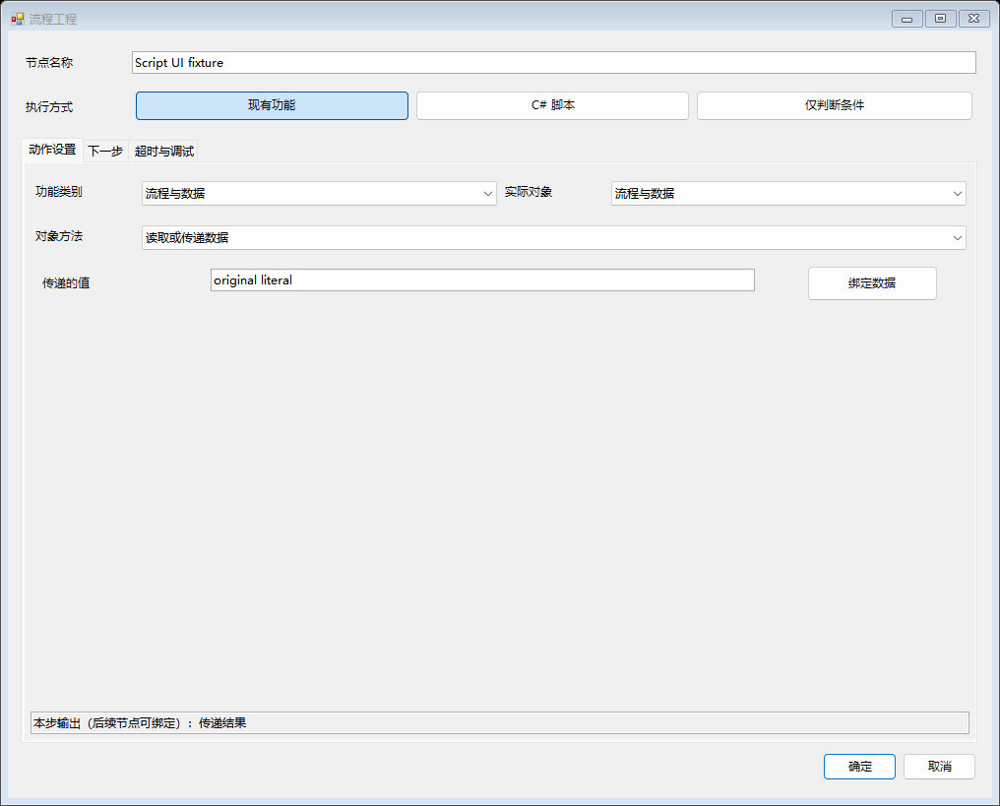
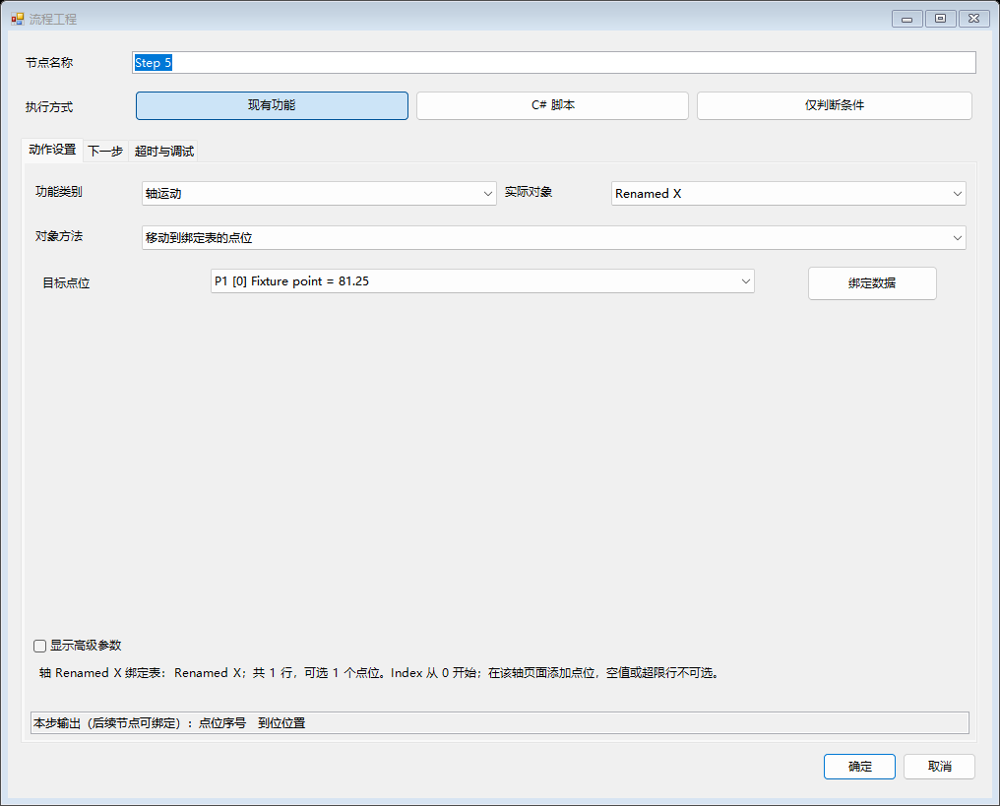
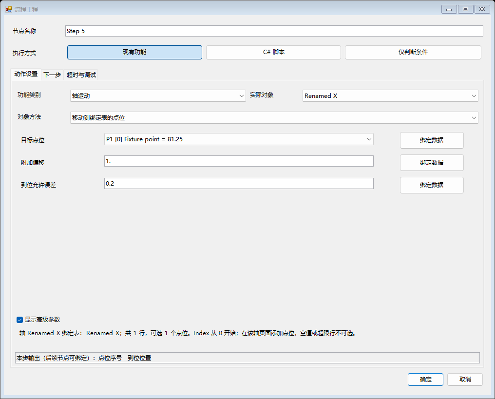
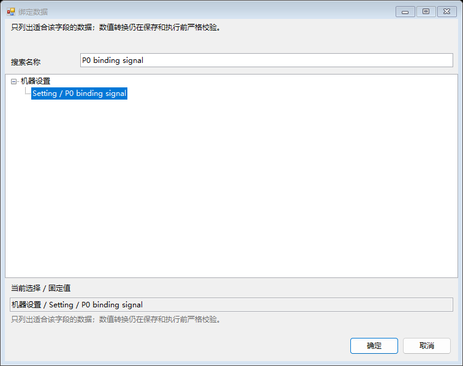
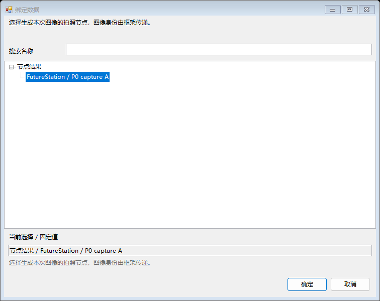
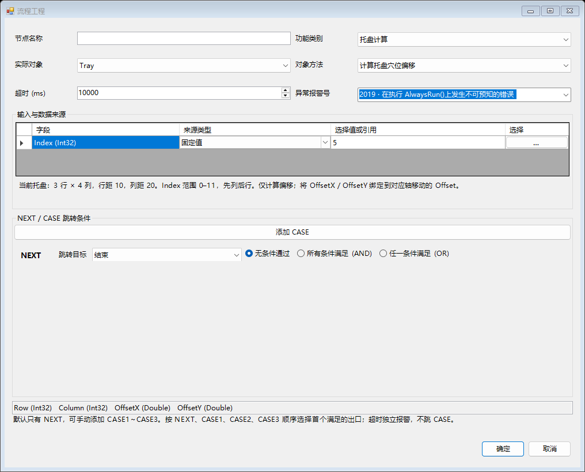

# 设备流程设计器使用说明

先在轴、IO、视觉和常量等现有页面配置设备对象，再用流程节点选择这些对象的动作。一个节点只需说明：本步执行什么、参数从哪里来、完成后去哪里。常规动作直接选择，特殊计算使用 C# 脚本；配置统一使用主界面【保存】。

## 从哪里打开

正常生成并运行 `AlphaRap/bin/x64/Debug/AlphaRap.exe`，登录维护员或管理员账号，机器处于 IDLE，进入主界面的【流程】页。页面访问仍受原系统角色权限中的 Rapid / 流程权限控制；拥有维护员角色但该项未授权时，需要由现场管理员在原权限设置中授权。其他角色可查看已获页面权限的流程，不能编辑或测试。

选择要编辑的流程模块和它的初始化页或自动页。新设备也可【添加流程模块】，直接添加、拖动和连接节点。

旧业务回调不会被猜测转换为设备动作。现有节点第一次导入时保留布局和连接，双击后由工程师明确配置实际动作；默认【保留原流程】允许逐步迁移。配置模式的可达路径中有未配置旧节点时，校验会明确拒绝运行。

## 配方只有 ProductManagerForm 一个入口

型号的创建、修改、使用、切换继续在 ProductManagerForm（物料管理）完成。流程设计器不增加另一套配方选择或配方存储。

节点参数旁的【绑定数据】可选择机器设置、当前配方和节点结果，包括现有 RecipeData / SettingData 及 ProductManagerForm 的 ProductSetting。点位来自 HardForm 等页面已有点位表与 ParameterSet 的轴关联；视觉使用 VPForm 当前配方已经加载的 VPP。

先在原页面修改参数、点位、设备和 VPP，通过主界面【保存】后再测试流程。每次启动建立当前配方名、已提交参数及点位快照；运行中禁止切换配方或保存参数。下一次启动自然使用 ProductManagerForm 新加载的配方。生产记录中的 ModelName 由框架自动填写。未保存的页面编辑值不会进入运行快照。

## 配置一个节点

节点顶部直接显示【现有功能】【C# 脚本】【仅判断条件】三个按钮。常规自动化动作使用【现有功能】，特殊计算才写脚本。下面按任务显示同一级页签：【动作设置】选对象和参数，【C# 脚本】写函数，【输入输出】设置脚本数据，【下一步】设置目标和条件，【超时与调试】设置异常处理。各模式只显示适用项；窗口不再同时堆放全部设置。详细步骤见[节点 C# 脚本与调试](FlowScripts.md)。

跳转和运行设置使用同级页面：[下一步](FlowProgramming/script-flat-routes-Chinese.png)、[超时与调试](FlowProgramming/script-flat-run-settings-Chinese.png)。原有对象、点位、常量和当前配方继续复用，节点【确定】仍只修改草稿。

1. 选择流程模块，勾选【编辑流程】。在当前初始化页、自动页或现有画布中【添加节点】，拖动节点调整位置，双击打开配置。
2. 使用【现有功能】时，在【动作设置】选【功能类别】→【实际对象】→【对象方法】。对象目录读取当前程序已有实例，不为浏览目录创建或连接设备。类别为空时，页面说明应去哪个现有页面创建轴、IO 或 VPP；原对象丢失时保留身份供修复。
3. 在【动作参数】直接填写业务参数：文字和数值直接输入，开关使用是 / 否，目标点位直接选择本轴表中的 `P1 [0]`、`P2 [1]` 等实际点位。需要其他数据时点击该行【绑定数据】，在同一窗口搜索并选择来源，不再先填写“来源类型”列。常用参数先显示，高级参数按需展开。
4. 打开【下一步】。新节点默认只有 NEXT，初始选择【无条件通过】。只需顺序执行时，直接选择 NEXT 的【跳转目标】；【结束】表示本模块本次执行结束。
5. 需要判断时选择 NEXT 的【所有条件满足（AND）】或【任一条件满足（OR）】，自动出现一条“左值 — 比较 — 右值”。两侧直接选本次结果、常量表、其他节点输出或上下文；固定值直接输入，是 / 否可直接选。结果使用“输入状态”“视觉判定通过”等业务名称，右侧按已选左侧字段类型筛选。比较显示“等于”“大于”等说明，仍保存原比较代码。布尔结果默认与 true 比较。内部运行编号默认不列入普通条件，旧工程已绑定的高级字段仍保留。【+ 添加条件】增加一行，行内右键删除。AND 要求所有行成立，OR 至少一行成立，无条件模式收起条件区域。切换语言不丢已选字段或正在输入的值。
6. 需要其他出口时点击【添加 CASE】，依次增加 CASE1、CASE2、CASE3，每条出口都有独立条件和跳转目标。添加第一个 CASE 时，无条件 NEXT 会切成条件编辑；若 NEXT 是单个布尔结果与 true/false 比较，CASE1 初始取相反值。其它情况由工程师补全条件；数值或布尔结果不能留空比较值。CASE 可单独移除，NEXT 始终保留。
7. 动作执行一次后，按 NEXT → CASE1 → CASE2 → CASE3 顺序选择首个满足条件的出口。如果均不满足，则持续检查条件，不重复发送设备动作。不能留下空的条件出口；无条件出口只能放在最后一个已配置出口，作为明确的默认出口。
8. 在【超时与调试】设置超时毫秒、异常报警号和可选节点断点。计时从节点动作开始，包含动作执行及出口等待；时间到立即请求报警，无需设置超时条件。动作异常同样报警并停止当前模块，超时和异常都不会自动跳到 CASE。真实执行通过 NPSDK.Alarm.Show 报警；模拟执行保留错误结果，不弹出设备报警。报警号留空时使用框架已有的 2019 报警，建议为实际节点选择合适的现场报警号。

固定控件和表头沿用 Name 登记语言，消息使用三语底稿与现场语言 XML。业务名称、参数键、输出字段和路径不翻译，切换语言不重建正在编辑的数据行。

对象绑定、真实端口、轴与点位关系及框架扩展方式见 [按实际对象配置流程节点](FlowObjectMethods.md)。

## 参数与绑定怎么选择

每行显示参数的业务名称和明确声明的单位，悬停可查看说明。轴移动默认只显示【目标点位】；勾选【显示高级参数】后再设置【附加偏移】和【到位允许误差】。等待输入的【稳定保持时间】也在高级参数内。旧节点已经填写非默认高级值或绑定数据时，会自动展开，避免原有设置被隐藏。收起高级参数只改变显示，不删除值，也不重置默认值。

【绑定数据】窗口把固定值、机器设置、当前配方、节点结果放在同一处。按业务名称搜索即可缩小列表；只推荐适合当前字段的数据，布尔参数不会混入文本或数值常量，数值之间允许绑定，具体范围与整数性仍在保存和执行前校验。选中后显示友好的来源名称，内部路径和节点身份由框架保存，不需要手填。普通参数可在该窗口选择【固定值】，也可在参数行右键选择【使用固定值】。

原来已失效的点位选项或数据引用会保留供修正，不自动选取第一项或替换成零。固定值的未完成输入、搜索内容和已选来源会在语言切换时保留。配置窗口【取消】不改变原节点，【确定】只提交内存草稿；仍由主界面【保存】统一校验和落盘。

【读取输入】只采样一次，适合立即判断当前状态；需要等待信号变化时，使用【等待输入稳定】，选择【等待状态】，需要时再展开稳定保持时间。对一次采样结果等待条件成立不会重新采样；出口条件也不会重复触发动作。

## 目前可选能力

- 流程与数据：取值、传值、加减乘除、索引计数、等待时间、操作员输入、报警、产品周期开始 / 结束。
- 数字输入（DI）：读取输入、等待稳定输入；只列真实输入对象。读取无需参数，下方直接使用返回的【输入状态】设置条件。
- 数字输出（DO）：设置输出、读取输出状态；只列真实输出对象。气缸动作与到位检查在独立【气缸】类别。
- 常量表：选择 Setting 或 Recipe 表，按业务键读取或设置实际表值，输出有类型的 Value；文件统一由主 Save 保存。
- 轴运动：实际轴编码器 / 指令位置、停止、回零、报警复位、只按该轴已绑定表的【目标点位】移动及显式偏移，不再另选 Table。
- 托盘计算：按当前型号的托盘行列与间距计算穴位偏移，独立于轴对象类别。
- 视觉：选择 VPForm 已有 VPP，绑定真实 ToolBlock 输入，读取视觉判定、X / Y / 角度结果和实际终端输出；读取输出、保存照片时选择【来源拍照节点】，并可显式读取本站补偿项目。
- 设备：已有 DeviceControl 实例的连接 / 断开、支持原始收发的设备命令、Keyence 扫码、ATEQ 气密结果、HIOKI 多通道结果、Keyence 3D 触发 / 切程序、Modbus 寄存器读取。
- PLC：程序中已配置 INOVANCE 对象的读写，沿用其地址和数据类型接口。
- 本地数据：DataForm 定义字段，选择节点输出映射到业务字段并保存；保存成功返回 RecordId 和 Path，可供后续节点继续使用。

设备只展示实例通过 IFlowObject 声明的实际方法。浏览对象不等于允许直接反射调用任意 .NET 方法；增加全新设备协议时，SDK / 驱动开发者仍需要编写一次适配，应用工程师随后复用目录。

## 一个最小测试流程

1. 在 DataForm 的【生产表字段】中定义 `Barcode`（Text）、`Measurement`（Number）、`Result`（Text）。流程工具栏也可以打开同一字段窗口。
2. 新建流程模块，添加“读取型号”节点，动作【读取或传递数据】，在【传递的值】旁点击【绑定数据】，选择当前配方中的 ProductManagerForm / ProductSetting / PRODUCTID。
3. 添加“测量”节点，同样使用【读取或传递数据】，先填写固定值 `2.5`。NEXT 选择【所有条件满足（AND）】，条件设为当前动作结果【传递结果】小于等于 `3`，目标选“保存 OK”。点击【添加 CASE】增加 CASE1，条件设为当前动作结果【传递结果】大于 `3`，目标选“保存 NG”。
4. 两个保存节点都选择 DataForm 的【保存生产记录】动作。Measurement 点击【绑定数据】选择“测量 / 传递结果”，Barcode 可先绑定“读取型号 / 传递结果”，Result 分别填写 OK / NG。用户自己定义的生产字段名保持原样。
5. 设置自动入口为“读取型号”，运行模式为【使用可配置流程】，点击【校验】，再点击主界面【保存】。
6. 通过机器设置启用 `Simulation`，退出全部模块的编辑模式，点击主界面原有【初始化】，完成后点击【启动】。流程页不再提供独立的初始化 / 启动按钮或另一套模拟开关。模拟模式仍真实保存本地记录，并固定附加 `Simulated=True`，不会访问相机、PLC 或运动硬件。
7. 在原生产数据查询入口查看结果；CSV 按天写入原 ProductionDataStore 路径。没有自定义生产根目录时，沿用框架既有默认路径。
8. 再把“测量”改成实际 VPP 或设备方法，把 Barcode 改成扫码节点输出，重复校验、模拟测试和保存。

已保存工程是生产版本。主界面的原有【初始化 / 启动 / 暂停 / 停止】负责正式运行，使用已保存版本和机器原有 Simulation 参数。流程草稿须先校验和保存，未保存的草稿不会改变主界面执行的版本。

主界面正式运行前，退出全部模块的编辑模式。只要有模块启用配置流程，其他模块也必须明确选为配置流程或停用，避免旧回调和新执行器同时驱动设备。每个配置模块选择初始化入口、自动入口；不需要初始化动作时可将初始化入口设为结束，正式启动仍需先执行主界面初始化。

## 节点调试怎么进入

编辑时在节点上右键【设置 / 取消断点】，或勾选节点窗口的【执行前断点】，通过主界面【保存】。退出编辑，在流程页开启【节点调试】，继续使用主界面原有【初始化 / 启动】；运行器先停在入口节点。选中模块，使用【单步执行节点】执行一个完整节点，或【继续】运行至下一个节点断点，观察本次输入、输出和所选出口。停止继续使用原停止按钮。

节点前暂停不计入该节点超时。【节点调试】是当前会话开关，关闭后普通运行忽略节点断点。这个单步面向 FlowChat 节点；脚本内部 C# 逐行调试使用 VS 附加与 F10 / F11，见[两类断点的区别](FlowScripts.md#节点调试与-c-行级调试)，不会自动启动 VS。

## 常量表绑定

系统设置页提供 Setting 和 Recipe 常量表，可新增、修改、按行右键删除、按键或说明查询。Setting 不随配方切换；Recipe 跟随 ProductManagerForm 当前配方，直接存入当前配方 XML。Setting 初始示例为原页面的禁用扫码枪、使用空跑、禁用视觉、MES、门禁、复检、蜂鸣器和 3D。它们是供流程绑定的参数，不会因出现在表里就自动执行或绕过设备动作。

支持 Boolean、Integer、Number、Text。常量可以通过两种方式使用：节点选择【功能类别：常量表】→【实际对象：Setting / Recipe】→【读取常量值】，在【表中参数】直接选常量，后续节点使用其输出【参数值】；或在任意合适的方法参数旁点击【绑定数据】，从机器设置 / 当前配方选择该常量。NEXT / CASE 条件仍在左右值下拉中直接选择对应常量。无需手写路径。引用仍按 `Constants/Setting/键` 或 `Constants/Recipe/键` 保存，不受排序和行号变化影响。编辑器显示草稿，正式运行使用已保存配置或流程明确写入表中的值，普通页面草稿不会自动发布。

直接绑定和常量读取节点均参与引用保护：被使用的键禁止删除、改名或改变类型。DisScann 和 UseTryRun 保留原 PSet 兼容字段及布尔类型；首次迁移保留现场值。删除示例保存后不再自动重建。切换配方时如有未保存 Recipe 常量或组合轴点位，会要求先使用主界面【保存】；选择“否”可放弃。Setting 草稿保持独立。

常量表还提供【设置表值】：选 Setting 或 Recipe，在【表中参数】选择已有键，把【新值】设为固定值、另一常量或节点输出。它直接修改实际表行，页面和后续流程读取新值，新批次也继续使用这个值；不会自动写文件或改变类型。停止后点击主界面【保存】才落盘；选择“否”放弃修改恢复上次保存。保存失败保留当前表值和旧文件。DisScann / UseTryRun 同步更新旧 PSet 当前行，旧接口的已提交读取仍在主保存后生效。普通页面的手工草稿不混入生产读取。

轴点位列表显示点位序号、内部索引、备注与坐标，节点提示本轴绑定表、总行数和可选点数；索引从 0 开始，P3 对应 2。若只有 P1，核对该轴页面的表是否只有一行，在同一表添加点位后重新打开节点即可选择。另一轴有三行不表示当前轴也有三行，不能跨表自动合并。空值或超出该列限位的点位不会出现在可选列表。

## 保存照片时选择哪个结果

先配置【拍照并运行当前 VPP】节点。后续节点仍选择同一个 VPP，使用保存照片或读取指定输出方法，在【来源拍照节点】旁点击【绑定数据】，只列出该 VPP 的拍照执行节点。选中对应节点即可，框架自动绑定该节点的结果编号，不需要输入 RunId，也不会从其他相机或其他 VPP 获取结果。

多次拍照时必须明确选择来源。该 VPP 已再次运行后，旧结果仍按原规则拒绝读取或存图，避免把另一产品的照片当作当前结果；本次没有增加图像历史缓存。存图使用该 VPP 页面已有存图配置。视觉补偿需要在轴的【显示高级参数】中，把【附加偏移】绑定到所需补偿输出，不会自动叠加到运动。

## 托盘计算怎么用

1. 在原【Plat Setting / 托盘参数】页面配置所选托盘的行数、列数、行距、列距，使用主界面【保存】。型号切换由 ProductManagerForm 管理。
2. 节点选择【托盘计算】→ 实际托盘（如 Tray）→【计算托盘穴位偏移】。【穴位序号】从 0 开始，先走完一行的列，再到下一行；节点下方直接显示当前行列、间距及有效索引范围。
3. 例如 3 行 × 4 列、行距 10、列距 20，穴位序号 5 返回行序号 1、列序号 1、X 方向偏移 20、Y 方向偏移 10；行列也从 0 开始，即现场第 2 行第 2 列。穴位序号 0 对应第一穴，偏移均为 0。
4. X 轴移动节点选择自身表中的托盘基准点，勾选【显示高级参数】，将【附加偏移】绑定到托盘节点的【X 方向偏移】；Y 轴同理绑定【Y 方向偏移】。间距与轴点位使用相同单位。托盘节点只计算，轴移动仍需分别配置。
5. 全盘处理可在前面放【循环索引】，起始序号为 0、结束序号为 11，高级参数【每次增加】默认为 1，将其【当前序号】输出绑定到托盘的【穴位序号】；再顺序连接 X 移动、Y 移动、拍照 / 测量和数据保存。循环路径须由实际 NEXT / CASE 条件明确设计，并遵守框架现有周期规则，本次未增加完整托盘遍历动作。

## 跨流程传数据与循环

输出引用保存模块和节点稳定 ID，修改显示名称不破坏引用。读取只接受同一次运行批次、同一产品周期中已完成节点的结果；未完成、已取消、旧批次和其他产品的值不能作为默认零继续生产。

单次流程可直接使用默认批次关联。连续生产时，在每件产品流程前增加【开始产品周期】：【产品标识】留空可生成唯一周期；多模块传递同一件产品时，各模块必须使用同一业务关联键，例如条码或已规划的载具周期号。消费者可以用“等待条件 + 其他节点输出”等待结果。

所有消费者读取并保存完成后，由最终汇总流程执行【结束产品周期并释放结果】。该动作清除这个产品的共享结果，不能在其他模块仍需读取时提前执行。重新经过同一节点的循环必须先经过开始周期节点；当前版本不支持无边界的任意回跳重试。跨模块生产节拍、产品键分配和消费者完成顺序由设计的流程明确配置，尚未提供自动多产品队列调度。

## 删除节点和流程模块

节点右键【属性编辑】与双击打开同一配置窗口，需要启用【编辑流程】。按实际右键命中的节点定位，【取消】不修改定义，【确定】仅提交草稿，最终由主界面【保存】落盘。

- 在节点表面或内部按钮上右键，选择【删除节点】，确认后删除实际右键命中的节点，不依赖工具栏当前选项。工具栏不再提供删除按钮。操作需要维护员 / 管理员权限，机器和流程必须停止。
- 删除节点会清理初始化 / 自动入口和指向它的 NEXT、CASE1、CASE2、CASE3 连接。其他节点的输入或出口条件若仍引用该节点输出，会列出引用位置并拒绝删除；先调整数据来源再删除。
- 在 Flow_BaseForm 页签标题上右键选择【删除流程模块】。检查整个窗体，包括不可见的初始化 / 自动页和嵌套容器；任何位置仍有 FlowChat 或模型节点时均拒绝删除。先逐个删除全部节点，才能确认删除空模块。
- 删除后点击主界面【保存】才成为生产版本。未保存可【重新加载】撤销。空模块以 Removed 标记和 Disabled 模式持久化，避免原有派生 Form 在下次启动时重新出现或执行旧回调；不删除应用 C# 类型。被删除模块名称继续保留，用不同名称创建新模块。

CASE 标题右键可移除该 CASE，NEXT 保留；条件行及生产表字段行在实际行上右键删除。新增行与表头空白区不沿用之前的删除目标。

组合轴、IO 的配置、保存与右键删除见 [组合硬件资源使用说明](HardwareResources.md)。

## 保存、重启、暂停与停止

- 工程保存在机器设置目录的 `FlowPrograms.xml`，版本为 2：节点稳定身份、原控件名和父容器、逻辑坐标、动作、对象、参数来源、每条出口自己的条件、NEXT / CASE1 / CASE2 / CASE3 连接、超时、报警、模块模式和入口，以及节点执行方式、脚本源码 / 端口 / 允许调用对象与节点断点。滚动画布不会改变保存的逻辑坐标。成功保存后发布生产版本，并保留前一版 `.bak`。
- 可读取版本 1 的旧工程。旧版已配置节点若使用公共条件或条件不满足 / 异常出口，必须双击节点重新核对各 CASE 条件并确定保存，校验通过后才能执行；不会把旧异常出口静默改成 CASE2 条件。原回调节点仍须完成动作配置。新版工程请使用新版程序打开。
- DataForm 字段窗口的【确定】只提交草稿，由主界面【保存】将字段定义写入同目录 `DataForm.Production.xml`。生产数据使用原 ProductionDataStore CSV 与查询入口，同一天加字段会扩展文件表头并保留已有行。
- 下次启动自动恢复已注册派生窗体的定义及运行时创建的普通模块。加载损坏文件时拒绝静默覆盖；先恢复备份，再重新加载。
- 重启只恢复设计，不自动恢复运行中的硬件动作，也不自动重发上次扫码、运动或保存命令。
- 暂停位于节点边界：已发出的动作继续完成并保留资源，恢复时不重复发动作。节点已选择出口后，边界暂停不继续计算该节点超时。停止请求取消；旧式阻塞 SDK 方法超时仍立即请求报警，但返回前继续显示运行 / 停止中，不提前释放资源。运动停止后检查忙状态再释放。
- 同一轴、输出、设备或相机通道的流程动作持有资源租约；SDK 手动轴运动和输出入口检查占用。停止入口保持可用。现场其他绕过这些入口的业务代码仍须在接入时审查。

## 验证与当前边界

执行 `tests/FlowProgramming/Run.ps1 -AssemblyDirectory AlphaRap/bin/x64/Debug` 可运行离线流程回归及真实启动 / 主保存检查。回归覆盖派生窗体接入、ProductManagerForm 配方切换、实际点位表关联、设备实例复用、参数到结果到 DataForm、生产记录去重、超时取消、跨周期隔离、草稿与运行版本、保存 / 放弃 / 重载及损坏文件保护。

参数交互专项覆盖轴常用参数与高级展开、旧非默认值自动显示、固定布尔值与点位选项、失效旧选项保留、统一绑定的搜索和类型筛选、同一 VPP 拍照来源以及三语切换不丢编辑值。验证结果以本次交付记录为准；离线控件回归不代替现场设备操作或应用工程师验收。

所有新增配置统一通过 MainForm【保存】持久化；轴 / IO、常量和流程工具栏不设置独立保存按钮。节点设计器可绑定未保存的常量、点位和字段草稿，正式运行使用已保存快照；常量设置节点明确写入实际表的值可供后续流程和新批次读取。主保存先校验和暂存配置，再替换文件并发布运行版本；失败不提交内存快照。主保存选“否”还原配置。生产记录在流程运行时自动落盘，属于业务动作。

当前已提供业务参数与统一绑定、可选的小段 C#、仅判断条件节点，以及同一运行器的节点断点和观察值。脚本为 C# 5、同进程非沙箱；受控对象调用会收拢完成，停止仍需等待不合作的实际动作返回，详见[脚本边界](FlowScripts.md#缓存与第一版边界)。产品周期与循环分离、有限重试、自动托盘遍历、子流程、统一“本件记录”、多产品调度以及配方整体切换事务尚未实现。未进行现场电机、PLC、扫码枪和相机联调；VS 交互式设计器仍需实际验证。
