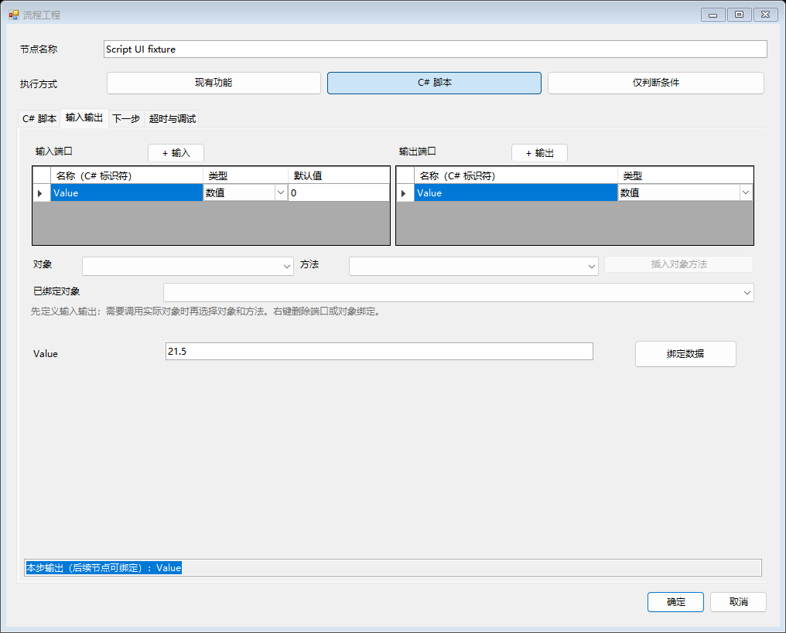

# 节点 C# 脚本与调试

常规轴、IO、视觉、扫码和生产保存继续选择【现有功能】，由实际对象执行。特殊计算或需要组合调用时，点击节点窗口顶部直接可见的【C# 脚本】按钮；只需要按数据分流时选择【仅判断条件】。三种方式共用 NEXT / CASE、超时、报警、保存和运行器。

## 配置第一段脚本

1. 机器处于 IDLE，以维护员或管理员进入【流程】，启用编辑，双击节点。
2. 点击顶部【C# 脚本】，立即进入源码页。默认示例 `Outputs.Value = Inputs.Value;` 已有一个数值输入和输出，点击【编译检查】即可检查。
3. 需要更多数据时打开同一级【输入输出】页，定义输入端口 `Value`、`Limit`，均为【数值】；把默认输出 `Value` 改名为 `Measurement`，保持【数值】，再新增【布尔】输出 `Accepted`。删除使用实际端口行的右键菜单。
4. 返回【C# 脚本】页，只填写函数体，例如：

```csharp
Outputs.Measurement = Inputs.Value;
Outputs.Accepted = Inputs.Value <= Inputs.Limit;
```

5. 在【输入输出】页的参数行，把 `Value` 绑定到测量节点的输出，把 `Limit` 绑定到当前配方的限制参数，也可先用固定值测试。
6. 在【下一步】页使用当前脚本结果 `Accepted`：NEXT 判断为 true 时走合格路径，按需增加 CASE1 判断 false 时走不合格路径。超时、报警和执行前断点集中在【超时与调试】页。
7. 点击【编译检查】，处理含源码行列的错误。编译成功只表示代码和端口通过检查，不会执行脚本或保存工程。
8. 点击节点【确定】，再用主界面【保存】统一持久化。退出编辑后，通过原有【初始化 / 启动】运行已保存版本；先使用原机器设置中的模拟模式验证数据和分支。

脚本编辑、端口、输入绑定和断点都属于节点草稿。【取消】不修改原节点；语言切换不翻译源码或端口名，也不清空编辑值。保存、放弃修改和重启加载继续使用 MainForm 的原入口。



源码页保留代码、编译按钮与短提示；没有诊断时收起信息区，修改代码会清除上次编译结果。端口表和对象目录在同一级【输入输出】页，不再占用源码编辑区域。

## 输入、输出和语言版本

脚本使用 **C# 5**，支持 `async` / `await`、普通循环、泛型集合与 LINQ。字符串插值、`nameof`、空条件运算符等更新的语法不在此版本范围内；`catch` 中不能直接 `await`，需要重试时在 `catch` 设置标志，再在其外部等待重试。只写函数体，不需要声明 `Main`、命名空间或完整类。

三个名称区分大小写：

- `Inputs.端口名`：本次节点已经解析的输入，只读；固定值或数据引用在【输入绑定】中配置。
- `Outputs.端口名`：本次节点的输出。每个声明输出都必须实际赋值，之后才允许按 NEXT / CASE 继续；输出端口默认值不会代替赋值。
- `Context`：当前调用信息、取消信号和受控的对象方法调用入口。

端口类型只有四种：Boolean 对应 `bool`，Integer 对应 `long` / Int64，Number 对应 `double`，Text 对应 `string`。整数不能传入小数或越界值，数值不接受 NaN / 无穷。端口名称使用合法 C# 标识符，同一输入列表或输出列表不能重复；不使用关键字、`@` 或框架保留的 `__` 前缀。输入和输出可以同名，通过 `Inputs` / `Outputs` 区分。

空默认值表示未提供默认值，不代表数值零；已填写的默认值会按端口类型检查。输入缺失、输出未赋值或类型不符时明确报错，不能以默认零、空串或上一次结果继续。

## 调用实际对象

在【输入输出】页的对象目录中选择现场实际对象及其方法，点击【插入对象方法】，窗口自动回到源码页。编辑器会插入 `await Context.CallAsync(...)`，并把该实际对象登记到【已绑定对象】。调用参数来自对象声明的默认值；工程师仍需按工艺改为所需的 `Inputs.名称` 或固定值。

`CallAsync` 的三个参数分别是稳定对象 ID、稳定方法 ID、输入字典。输入键、类型和结果字段取自该对象的实际方法。它经由与普通节点相同的调用管线执行，保留原来的参数检查、模拟行为、资源占用和取消处理。应使用 `await` 后再读取结果；可用 `Context.Get<T>(调用结果, "字段名")` 读取类型明确的结果，缺失字段或无法转换时会报错。

框架会登记通过此 Context 发起的每次对象调用。即使脚本漏写 `await`，节点也必须等全部已登记调用实际完成后才能发布输出；未被脚本读取的调用错误会使节点失败。脚本可以捕获已经等待的调用异常并重试，框架不会再次抛出已处理的旧错误。返回值支持直接 `await` 和 `ConfigureAwait(false)`，属于受控等待对象，不能直接当作 `Task` 传入 `Task.WhenAll`。同一返回值多次等待不会重复发送设备动作。

用户函数抛错、取消或输出校验失败时，框架取消同一调用作用域，并继续等已有实际动作结束，不会提前释放占用。后续调用的异常作为补充诊断保留，不覆盖用户函数已经抛出的原异常。用户函数结束后关闭新调用入口，延后的后台任务不能再借此 Context 启动设备方法。

只允许调用此脚本已登记的实际对象。对象删除后，保存 / 启动校验会提示修复绑定；从【已绑定对象】移除一项不会自动改写源码，需要同时删除或替换对应调用。不能靠手写另一个对象 ID 绕过这项登记。

该入口不提供原始驱动实例。调用的是对象已经声明的方法，不是任意 .NET 方法反射；新增协议仍由框架开发者实现并声明一次，然后由脚本或普通节点复用。

## 配方、数据保存与取消

脚本源码、端口和允许调用的对象清单随机器级 `FlowPrograms.xml` 保存，不随 ProductManagerForm 切换配方。需要随型号变化的限制、点位索引和工艺参数，通过输入端口绑定当前 Recipe 数据；Setting 参数保持独立。不要为每个型号复制一份脚本或增加第二个配方入口。

`Context.RecipeName` 是本次运行上下文中的配方名，`Context.Simulation` 表示当前模拟状态。生产数据仍通过 DataForm 保存动作或其受控调用产生；同一脚本中的每次保存具有独立调用编号，保留当前产品关联，不会把第二条记录误当重复记录。配置文件仍由主 Save 保存，二者不混用。脚本输出可像普通节点输出一样绑定到后续节点，继续遵守同一批次和产品周期的结果有效期。

异步等待与长循环必须配合当前取消信号。例如：

```csharp
Context.Token.ThrowIfCancellationRequested();
await Task.Delay(100, Context.Token);
Outputs.Measurement = Inputs.Value;
Outputs.Accepted = true;
```

`Context.CallAsync` 在调用前后检查取消，所有调用共用与当前节点关联的作用域取消信号。停止或超时不会安全地强制终止任意 C#；不配合取消的阻塞代码或设备方法仍需等待它实际返回，期间不能把占用对象提前交给其他节点。避免使用不可取消的无限循环或长时间 `Thread.Sleep`。关闭节点作用域后会释放内部取消资源，`Context.Token` 的值仍可读取，但不能再启动受控调用。

## 节点调试与 C# 行级调试

节点右键【设置 / 取消断点】或节点窗口的【执行前断点】修改同一节点断点草稿，主 Save 后持久化。在流程页开启【节点调试】，退出编辑，通过主界面原有【初始化 / 启动】开始；调试先停在入口。选中模块后，【单步执行节点】执行一个完整节点，【继续】运行至下一个节点断点。观察面板显示本次输入、输出和所选出口，不重新读取硬件来填观察值。暂停在节点执行前不消耗该节点超时时间。

【节点调试】是当前会话开关，不另建初始化或启动入口；关闭后普通运行忽略工程中的节点断点。脚本可以在一个节点内包含多行 C#，流程面板的单步不会逐行执行这些语句。

观察面板的三语回归截图：[中文](FlowProgramming/script-debug-page-Chinese.png)、[English](FlowProgramming/script-debug-page-English.png)、[Español](FlowProgramming/script-debug-page-Español.png)。截图使用模拟数据，展示实际控件中的输入、输出与出口。

需要逐行查看 C# 时，使用 Visual Studio 附加到当前 AlphaRap 进程。编译检查成功后显示【调试源码】路径，可打开该 `UserScript.cs`。脚本以关闭优化的 Debug 方式编译并保留 PDB；节点调试进入带节点断点的脚本时，仅在调试器已经附加的情况下调用 `Debugger.Break()`，位置映射到用户脚本第一行，不自动启动调试器。随后使用 VS 的 F10 / F11，或在该文件中设置 VS 行断点。

VS 行断点由 VS 管理，不由 Main Save 保存，和 FlowChat 节点断点各自独立。VS 暂停整个进程发生在动作内部，可能影响超时和通信；不等同于运行器在节点前等待。

编译错误显示 `UserScript.cs(行,列)`。运行异常在 PDB 可定位时显示用户文件和真实行号，详细异常仍保留原堆栈；如果异常没有用户源码帧，会明确只提供源码路径，不伪造行号。

## 缓存与第一版边界

源码和生成包装、DLL、PDB 存在当前程序的本地临时缓存目录。缓存身份包括源码、输入 / 输出端口、允许调用对象清单和实际宿主 / NPSDK 程序集版本；同一版本不会在每次节点执行时重新编译。工程中的源码才是持久化依据，缓存不是另一份配方或工程文件。

每个进程最多加载 256 个成功编译的脚本版本。达到上限时明确提示先保存工程并重启程序，不能仅删除缓存字典就声称已卸载程序集。编译失败不会被当作可执行版本。

这是同进程的普通 C#，**不是安全沙箱**。`Context.CallAsync` 约束的是通过该入口发出的设备调用，不限制 C# 自己访问文件、网络或其他进程能力；模拟模式也不会自动拦截这些任意 C# 操作。源码应由受信任的工程人员维护，优先复用已有功能与受控调用。

本版提供节点脚本、端口绑定、编译诊断、节点断点和外部调试器对接；不提供完整 IDE、自动补全、任意 NuGet 引用、隔离脚本进程、强制终止任意代码或自动历史图像缓存。产品周期与循环规则仍沿用原运行器，本次没有增加任意回跳重试、自动托盘遍历或多产品调度。
