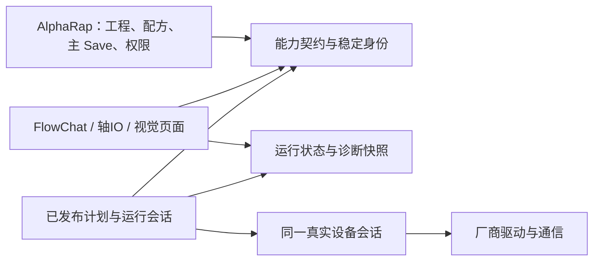

# AlphaRap / NPSDK 整体优化路线

评审日期：2026-10-24。本次是当前版本的静态架构复核，建议尚未实施；没有修改运行代码或核心 DLL。

## 判断与范围

最值得投入的是配置与运行的一致性、稳定对象身份、可复用工艺和可解释的故障。现有 `IFlowObject / FlowMethod / FlowField`、NPSDK FlowChat、资源租约、发布快照和类型化数据流可以继续作为基础。

- 宿主依据：`79910792cce04e6d35a19b060a2bfc127eee46c6`；主程序 200 个显式 Compile 文件，NewPowerLibrary 4 个。数量包含设计器，不是业务类数量。
- 核心依据：NPSDK `4e21ed45c872d7eb41b314b19ff6eef85185a43f`。逐一核对其 184 个显式编译输入，审查镜像与该提交内容一致；这项校验不代表逐条实机验证所有驱动分支。
- 发布 DLL：`SDK/lib/NPSDK.dll`，484864 字节，SHA256 `c1edf789d3fcac93fe5b622d9de5aa7c688a23fc03f3bbd394745d6059016929`。没有把外部 SDK 工作区未提交的运动控件变更算作已交付能力。
- 重点链路：启动/停机、Main Save、配方加载、ModuleBaseForm、设备与 IO/轴接口、流程调度与绑定、脚本、视觉配置、DataForm、语言、用户权限和程序集依赖。
- 以下现状主要为源码静态确认；后果和收益属于有条件推导，验收栏是后续应新增的验证。没有读取厂商原生 DLL 内部实现，也没有在本轮启动硬件、重跑全部回归或完成性能测量。
- 上一交付的 104 项流程脚本、7 项启动保存、62 项视觉语言检查是历史基线，不证明本报告中的故障注入、掉电恢复或硬件验收已完成。

继续遵守：真实对象复用；轴只选自身绑定表；VPP 来自 VPForm 的真实配置；ProductManagerForm 唯一配方入口；Setting 独立；配置由 MainForm Save 保存；三语保留业务键与草稿；固定控件保持设计器预览；删除在命中对象的右键菜单。

P0 表示下一轮优先处理的运行正确性边界；P1 表示应用工程师使用和发布前基础整改；P2 表示在边界稳定后提高维护、性能与交付能力。它们是建议次序，不是已完成清单。

## P0：先保证同一个工程、同一套设备状态

### P0-01 让主 Save 真正覆盖全部配置

**已有基础：**核心配置已有暂存、整体替换、异常回滚和成功后发布，应该沿用。

**剩余缺口：**MainForm 先提交核心配置，再另存权限、视觉和 Device；部分保存函数不向主入口返回失败。视觉页面还有 CRUD 直接写盘，不能把统一按钮等同于统一事务。现有回滚也没有断电恢复日志。

**渐进做法：**先把视觉、设备和权限接入现有事务的校验、写暂存文件、提交内存三个动作；全部成功才发布版本和记成功日志。随后补持久化提交清单，启动时识别并恢复中断的保存。

**工程师收益：**工程师只需理解一次主保存；失败时知道哪些内容仍是草稿，重启后不会加载一半新、一半旧的工程。

**验收：**分别让相机配置、设备配置和权限文件拒写，确认全部旧文件及运行版本不变；模拟中途结束进程后可恢复到完整版本。后者需要新增测试，不能由现有异常回滚测试推导。

**证据：**[AlphaRap/Configuration/ProjectConfiguration.cs:31](https://github.com/NewPowerSW/AlphaRap2.08/blob/79910792cce04e6d35a19b060a2bfc127eee46c6/AlphaRap/Configuration/ProjectConfiguration.cs#L31)；[AlphaRap/MainForm.cs:1528](https://github.com/NewPowerSW/AlphaRap2.08/blob/79910792cce04e6d35a19b060a2bfc127eee46c6/AlphaRap/MainForm.cs#L1528)；[AlphaRap/MenuForm/VPForm.cs:1737](https://github.com/NewPowerSW/AlphaRap2.08/blob/79910792cce04e6d35a19b060a2bfc127eee46c6/AlphaRap/MenuForm/VPForm.cs#L1737)；[AlphaRap/Controls/DeviceControl.cs:690](https://github.com/NewPowerSW/AlphaRap2.08/blob/79910792cce04e6d35a19b060a2bfc127eee46c6/AlphaRap/Controls/DeviceControl.cs#L690)。

### P0-02 配方先整体预检，再一次切换

**已有基础：**ProductManagerForm 是唯一入口，已有运行/视觉忙拦截、部分草稿检查和 Setting/Recipe 区分。

**剩余缺口：**OpenRecipe 先改 SysPara，再逐模块读入；ModuleBaseForm 先清表再读文件，部分合并错误被忽略。外层捕获的异常会改为默认 Recipe；部分内部失败可能未被汇总为切换失败，视觉加载又在外层 try 之后。启动没有据 OpenRecipe 返回值阻止后续扫描和 ServoOn。

**渐进做法：**整份配方只读一次到临时快照，验证全部模块表、点位、常量和 VPP；成功后统一切换型号与对象状态，最后写 INI。失败保留原配方。初始化汇总配方、对象和设备就绪结果，全部满足后才允许启动。

**工程师收益：**换型号不会留下混合参数，也能减少逐页重复解析 XML；工程师看到的型号与实际执行版本一致。

**验收：**缺文件、损坏表、缺 VPP、某模块不兼容时，型号、点位、视觉及旧运行快照均保持原值；未就绪对象明确阻止依赖流程。

**证据：**[AlphaRap/Core/MiddleLayer.Recipe.cs:38](https://github.com/NewPowerSW/AlphaRap2.08/blob/79910792cce04e6d35a19b060a2bfc127eee46c6/AlphaRap/Core/MiddleLayer.Recipe.cs#L38)；[AlphaRapLibrary/ModuleBaseForm.cs:133](https://github.com/NewPowerSW/AlphaRap2.08/blob/79910792cce04e6d35a19b060a2bfc127eee46c6/AlphaRapLibrary/ModuleBaseForm.cs#L133)；[AlphaRap/Core/MiddleLayer.Startup.cs:38](https://github.com/NewPowerSW/AlphaRap2.08/blob/79910792cce04e6d35a19b060a2bfc127eee46c6/AlphaRap/Core/MiddleLayer.Startup.cs#L38)。

### P0-03 通信失败、OFF 和动作完成必须分清

**已有基础：**FlowActions 已有真实对象租约、类型和就绪校验、独立模拟实现，运动完成检查也已有专用适配。

**剩余缺口：**底层输入读失败仍可能成为 false，未就绪位置可成为 0；NP_Output.On/Off 丢弃驱动返回值。Keyence Write 未校验接收字节数及协议确认，只要 Receive 未抛异常便返回 true；部分串口方法重复发送读取请求。SDK Simulation 标记不能据此保证手动、旧回调和直接控件调用都不触及真实驱动。

**渐进做法：**先给驱动补带状态、值、错误码和采样时间的结果；命令区分接受、执行中、完成和失败。按协议完整收帧，禁止非幂等命令盲目重发。真实/模拟选择落实到设备创建边界，并复用同一能力契约。

**工程师收益：**等待输入无效时不会把断线当作条件满足；报错能定位到具体设备。工程师在仿真和现场看到一致的完成与失败语义。

**验收：**离线注入断线、拆包、粘包、设备拒绝、超时与取消；失败不发布正常输出。仿真覆盖启动、手动和旧入口时真实驱动调用计数为零；具体运动语义仍需实机验收。

**证据：**[NPSDK/NPSDK.Motion/Controls/NP_Output.cs:128](https://github.com/JeffreyWub/NPSDK/blob/4e21ed45c872d7eb41b314b19ff6eef85185a43f/NPSDK/NPSDK.Motion/Controls/NP_Output.cs#L128)；[NPSDK/NPSDK.Motion/Controls/NP_Motor.cs:441](https://github.com/JeffreyWub/NPSDK/blob/4e21ed45c872d7eb41b314b19ff6eef85185a43f/NPSDK/NPSDK.Motion/Controls/NP_Motor.cs#L441)；[NPSDK/NPSDK.Motion/Vendors/Keyence/KeyenceHostLink.cs:116](https://github.com/JeffreyWub/NPSDK/blob/4e21ed45c872d7eb41b314b19ff6eef85185a43f/NPSDK/NPSDK.Motion/Vendors/Keyence/KeyenceHostLink.cs#L116)；[NPSDK/NPSDK.Motion/Controls/Base/NPControlBase.cs:67](https://github.com/JeffreyWub/NPSDK/blob/4e21ed45c872d7eb41b314b19ff6eef85185a43f/NPSDK/NPSDK.Motion/Controls/Base/NPControlBase.cs#L67)；[AlphaRap/Devices/ModBus_RTU.cs:263](https://github.com/NewPowerSW/AlphaRap2.08/blob/79910792cce04e6d35a19b060a2bfc127eee46c6/AlphaRap/Devices/ModBus_RTU.cs#L263)。

### P0-04 整机明确区分停止中与已停止

**已有基础：**新运行器会协作取消，并在实际任务完成前保持运行和资源占用；AnyRunning 已阻止提前编辑或重启。

**剩余缺口：**宿主 StopRun 先设 IDLE 再请求停止；退出仍依赖强制结束进程的兼容处理。启动和消息循环清理缺少外层 finally；AlarmRunTask 的无限循环没有退出条件，后台直接修改 UI。旧回调路径和新运行器的生命周期仍需收束。

**渐进做法：**用一个整机停止流程汇总 Runtime.Completion、手动任务、扫描和驱动停止确认；显示停止中及等待对象，完成后再进 IDLE。退出复用停止流程，最后冲刷日志和释放连接；后台发布快照，由 UI 线程更新。保留现有 Cognex 强制退出兜底直至替代路径验证通过。

**工程师收益：**操作员知道设备是否真正停止，维护员能定位为何不能退出；页面释放不再承担整机资源关闭的隐含职责。

**验收：**开始后立即停止、慢驱动、取消后迟到、重复暂停和退出均有可观测结果；正常退出无残留任务、日志冲刷可等待。软件停止与硬件急停分别验收。

**证据：**[AlphaRap/Core/MiddleLayer.RunControl.cs:99](https://github.com/NewPowerSW/AlphaRap2.08/blob/79910792cce04e6d35a19b060a2bfc127eee46c6/AlphaRap/Core/MiddleLayer.RunControl.cs#L99)；[NPSDK/FlowChart/FlowProgramRuntime.cs:258](https://github.com/JeffreyWub/NPSDK/blob/4e21ed45c872d7eb41b314b19ff6eef85185a43f/NPSDK/FlowChart/FlowProgramRuntime.cs#L258)；[AlphaRap/Tasks/AlarmRunTask.cs:23](https://github.com/NewPowerSW/AlphaRap2.08/blob/79910792cce04e6d35a19b060a2bfc127eee46c6/AlphaRap/Tasks/AlarmRunTask.cs#L23)；[AlphaRap/MainForm.cs:1752](https://github.com/NewPowerSW/AlphaRap2.08/blob/79910792cce04e6d35a19b060a2bfc127eee46c6/AlphaRap/MainForm.cs#L1752)；[AlphaRap/Program.cs:40](https://github.com/NewPowerSW/AlphaRap2.08/blob/79910792cce04e6d35a19b060a2bfc127eee46c6/AlphaRap/Program.cs#L40)。

### P0-05 保护点位删除和重排的引用语义

**已有基础：**动态硬件和 VPP 已有稳定身份，轴也只访问自己绑定的点位表；删除点位已有索引变化的通用确认。

**剩余缺口：**固定点位仍以行号保存；SDK 删行使后续索引前移，上移则交换行值。现有确认未列出受影响节点，引用可能仍合法却指向另一个坐标。旧资源身份还部分依赖控件路径、窗体和 CLR 字段名。

**渐进做法：**先在删行、替换和重排前列出受影响节点并保护引用；随后为固定选点增加隐藏 PointId，保留显示序号。点位定义的身份跨配方沿用，各配方只切换对应坐标，缺定义时明确报错。动态遍历仍使用 Index。旧对象通过显式别名迁移到稳定资源登记，不能按相似名称猜绑定。

**工程师收益：**维护点位表或调整界面布局不会无声改变工艺目标；工程师仍在原轴页选择自己的点位。

**验收：**在绑定 P3 后删除 P1、移动 P3 或改变备注，原目标不会悄悄变成另一行；跨配方按定义身份解析，缺失时阻止执行并定位使用节点。

**证据：**[AlphaRap/FlowProgramming/FlowResources.cs:246](https://github.com/NewPowerSW/AlphaRap2.08/blob/79910792cce04e6d35a19b060a2bfc127eee46c6/AlphaRap/FlowProgramming/FlowResources.cs#L246)；[AlphaRap/FlowProgramming/FlowAxisObject.cs:76](https://github.com/NewPowerSW/AlphaRap2.08/blob/79910792cce04e6d35a19b060a2bfc127eee46c6/AlphaRap/FlowProgramming/FlowAxisObject.cs#L76)；[NPSDK/NPSDK.Motion/Controls/NP_PositionTable.cs:285](https://github.com/JeffreyWub/NPSDK/blob/4e21ed45c872d7eb41b314b19ff6eef85185a43f/NPSDK/NPSDK.Motion/Controls/NP_PositionTable.cs#L285)；[AlphaRap/FlowProgramming/FlowResources.cs:184](https://github.com/NewPowerSW/AlphaRap2.08/blob/79910792cce04e6d35a19b060a2bfc127eee46c6/AlphaRap/FlowProgramming/FlowResources.cs#L184)。

## P1：让工程师能理解并复用完整工艺

### P1-01 同一产品内支持有限重试和子流程

**已有基础：**已有 CycleId、运行代次、循环索引和脚本；旧结果隔离机制应保留。

**剩余缺口：**普通节点再次访问会被 visited 拒绝，必须经过 cycle.begin；这把同一产品的重拍、重新扫码与开始下一件产品绑在一起。局部脚本能重试，但应用工程师仍要重复写工艺逻辑。

**渐进做法：**先做有次数上限、明确可重试动作的重试结构；再做具名类型输入输出的子流程和托盘遍历。产品身份保持不变，尝试/迭代和动作调用另有编号。子流程内部可展开，沿用同一取消和资源占用规则。

**工程师收益：**复用扫码、检测和搬运工艺时主要换对象、点位和参数，减少重复配置与脚本。

**验收：**同一条码检测失败后最多重拍三次，条码和产品身份不丢失；已执行的夹紧、保存等副作用不被隐式重发；下一件产品不会读到旧尝试结果。

**证据：**[NPSDK/FlowChart/FlowProgramRuntime.cs:277](https://github.com/JeffreyWub/NPSDK/blob/4e21ed45c872d7eb41b314b19ff6eef85185a43f/NPSDK/FlowChart/FlowProgramRuntime.cs#L277)；[AlphaRap/FlowProgramming/FlowUtilityObject.cs:40](https://github.com/NewPowerSW/AlphaRap2.08/blob/79910792cce04e6d35a19b060a2bfc127eee46c6/AlphaRap/FlowProgramming/FlowUtilityObject.cs#L40)；[AlphaRap/FlowProgramming/FlowTrayMethods.cs:10](https://github.com/NewPowerSW/AlphaRap2.08/blob/79910792cce04e6d35a19b060a2bfc127eee46c6/AlphaRap/FlowProgramming/FlowTrayMethods.cs#L10)。

### P1-02 直接解释为什么在等待、为什么失败

**已有基础：**已有节点断点、单步、输入输出快照和出口观察，可以继续扩展现场诊断。

**剩余缺口：**资源持有者主要是随机 GUID，条件等待主要显示 Waiting。资源申请、动作及出口等待共用一个超时；顶层常只保留 error.Message。工程师仍难判断是哪条条件没到、谁占着轴、失败属于哪个阶段。

**渐进做法：**从真实运行过程保留有界诊断快照：条件左右值及判定、占用模块/节点、等待时长、动作阶段、配方/产品/执行身份与原始故障。普通界面保留一个超时，高级设置再分阶段预算；观察界面不额外读取硬件。

**工程师收益：**维护员可直接回答哪件产品、哪个对象、哪条条件导致停驻，减少打开 VS 和猜报警号。

**验收：**人为制造资源竞争、条件一直不满足、来源未执行和动作超时，界面给出各自明确原因；关闭观察页不影响执行，诊断缓冲有上限。

**证据：**[NPSDK/FlowChart/FlowResourceGate.cs:37](https://github.com/JeffreyWub/NPSDK/blob/4e21ed45c872d7eb41b314b19ff6eef85185a43f/NPSDK/FlowChart/FlowResourceGate.cs#L37)；[NPSDK/FlowChart/FlowProgramRuntime.cs:400](https://github.com/JeffreyWub/NPSDK/blob/4e21ed45c872d7eb41b314b19ff6eef85185a43f/NPSDK/FlowChart/FlowProgramRuntime.cs#L400)；[NPSDK/FlowChart/FlowProgramRuntime.cs:286](https://github.com/JeffreyWub/NPSDK/blob/4e21ed45c872d7eb41b314b19ff6eef85185a43f/NPSDK/FlowChart/FlowProgramRuntime.cs#L286)；[AlphaRap/FlowProgramming/FlowDebugPanel.cs:26](https://github.com/NewPowerSW/AlphaRap2.08/blob/79910792cce04e6d35a19b060a2bfc127eee46c6/AlphaRap/FlowProgramming/FlowDebugPanel.cs#L26)。

### P1-03 给工程师一份明确的本件记录

**已有基础：**DataForm 已有具名生产字段、类型校验、RecordId 去重和本地 CSV 写入确认。

**剩余缺口：**当前主要通过各节点输出映射到保存动作，尚无统一的本件业务记录；重复工艺和后续上传要重复处理字段来源。查询虽然接收起止时刻，却主要按天选文件，没有逐条按精确时间过滤。

**渐进做法：**在当前产品上下文内提供一份有类型的本件字段，配置一次可见、可改的来源映射；DataForm 继续定义落盘表，保存成功才继续，失败保留本件记录。查询按实际时间筛选并报告坏文件。将来上传复用已保存 RecordId 与记录，不从界面临时拼数据。

**工程师收益：**工程师以条码、型号、测量、判定和照片路径理解数据，不必为每个保存节点重新找全部来源。

**验收：**一件产品多次检测后只保存约定结果，失败重试不重复追加同一记录；查询 09:00—11:00 不返回该日其他时刻；跨产品数据严格隔离。

**证据：**[AlphaRap/FlowProgramming/FlowProductionData.cs:137](https://github.com/NewPowerSW/AlphaRap2.08/blob/79910792cce04e6d35a19b060a2bfc127eee46c6/AlphaRap/FlowProgramming/FlowProductionData.cs#L137)；[AlphaRap/Classes/ProductionDataStore.cs:209](https://github.com/NewPowerSW/AlphaRap2.08/blob/79910792cce04e6d35a19b060a2bfc127eee46c6/AlphaRap/Classes/ProductionDataStore.cs#L209)；[AlphaRap/Classes/ProductionDataStore.cs:285](https://github.com/NewPowerSW/AlphaRap2.08/blob/79910792cce04e6d35a19b060a2bfc127eee46c6/AlphaRap/Classes/ProductionDataStore.cs#L285)；[AlphaRap/FlowProgramming/FlowDataMethods.cs:15](https://github.com/NewPowerSW/AlphaRap2.08/blob/79910792cce04e6d35a19b060a2bfc127eee46c6/AlphaRap/FlowProgramming/FlowDataMethods.cs#L15)。

### P1-04 收敛账户访问与脚本发布权限

**已有基础：**流程编辑已有维护/管理员和 IDLE 检查，手动资源入口也已有部分宿主权限保护。

**剩余缺口：**用户查询和增删改仍拼接 SQL，密码按明文比较；指纹路径按表行下标找人。同进程 C# 脚本不是沙箱，受控 Context 调用不能限制任意 C# 的文件或网络能力。

**渐进做法：**提供少量平铺可读的参数化账户 CRUD，迁移带盐密码哈希，指纹绑定稳定用户 ID；关键执行入口统一核对权限。脚本由受信工程人员维护，发布版本及操作者可追溯。

**工程师收益：**普通用户名含引号也不会破坏查询，用户排序/删除不会错配身份；谁修改和发布了设备逻辑可以追查。

**验收：**覆盖特殊字符账户、旧密码迁移、增删后指纹身份一致及越权直接调用；不把模拟或 Context 白名单宣传为安全沙箱。本项属于发布前的基础整改。

**证据：**[AlphaRap/MenuForm/UserLoginForm.cs:186](https://github.com/NewPowerSW/AlphaRap2.08/blob/79910792cce04e6d35a19b060a2bfc127eee46c6/AlphaRap/MenuForm/UserLoginForm.cs#L186)；[AlphaRap/MenuForm/AddUserForm.cs:328](https://github.com/NewPowerSW/AlphaRap2.08/blob/79910792cce04e6d35a19b060a2bfc127eee46c6/AlphaRap/MenuForm/AddUserForm.cs#L328)；[AlphaRap/FlowProgramming/FlowPrograms.cs:70](https://github.com/NewPowerSW/AlphaRap2.08/blob/79910792cce04e6d35a19b060a2bfc127eee46c6/AlphaRap/FlowProgramming/FlowPrograms.cs#L70)；[AlphaRap/FlowProgramming/FlowScripts.cs:258](https://github.com/NewPowerSW/AlphaRap2.08/blob/79910792cce04e6d35a19b060a2bfc127eee46c6/AlphaRap/FlowProgramming/FlowScripts.cs#L258)。

### P1-05 显示文字不再顺带同步写语言文件

**已有基础：**已有三语底稿、内存索引、现场译文优先和稳定业务键，方向正确。

**剩余缺口：**LangMsg 遇到缺键会通过 SetLangText 同步保存整份 XML；新页面第一次显示可能反复写盘。损坏语言文件读取失败后可能生成空文档，再由补键路径覆盖现场文件。

**渐进做法：**查找只读取或补内存并记录新增键，批量落盘接入既有主 Save 和语言编辑的提交机制；损坏文件保留原样，使用只读底稿并明确报错。语言切换继续只改标题，不重建业务数据。

**工程师收益：**新增页面打开更顺畅，现场翻译不会因显示一个缺失文案而丢失，也符合统一保存约定。

**验收：**缺少一百个文案时不发生一百次同步整文件写入；损坏/只读语言包不被覆盖；中英西切换仍保留脚本、绑定、点位与编辑值。

**证据：**[AlphaRap/Core/MiddleLayer.LanguageText.cs:78](https://github.com/NewPowerSW/AlphaRap2.08/blob/79910792cce04e6d35a19b060a2bfc127eee46c6/AlphaRap/Core/MiddleLayer.LanguageText.cs#L78)；[AlphaRap/Core/MiddleLayer.LanguageText.cs:106](https://github.com/NewPowerSW/AlphaRap2.08/blob/79910792cce04e6d35a19b060a2bfc127eee46c6/AlphaRap/Core/MiddleLayer.LanguageText.cs#L106)；[AlphaRap/Classes/LanguageCatalog.cs:93](https://github.com/NewPowerSW/AlphaRap2.08/blob/79910792cce04e6d35a19b060a2bfc127eee46c6/AlphaRap/Classes/LanguageCatalog.cs#L93)。

## P2：让程序和 DLL 更易维护、测量与交付

### P2-01 按职责分层，并生成已发布执行计划

**已有基础：**IFlowObject/FlowMethod/FlowField 已把真实能力声明和执行接上；SDK 运行器通过委托执行，发布快照和草稿也已区分。

**剩余缺口：**资源发现仍部分依赖控件树；控件兼任驱动和连接生命周期。FlowModuleEditor 同时管编辑、校验、启动和运行状态。每次节点执行再次校验，部分输出目录又扫描当前草稿节点，与已发布运行版本的边界不够清楚。

**渐进做法：**先在现有程序集内分清能力契约、运行器、设备会话和控件视图。原页面、FlowChat 绑定同一实例。保存/配方/资源版本改变时解析不可变执行计划，编辑器只管草稿；选择、保存和运行共用绑定规则。稳定后再按需拆 DLL，并保留 NPSDK 兼容入口。

**工程师收益：**调整界面布局不影响设备逻辑，新增设备不需修改多处大 switch；运行版本更可追溯，也减少重复解析和扫描。

**验收：**不创建 WinForms 页面也能离线校验/执行流程核心；修改未保存草稿不影响已发布计划的对象与输出目录；编辑器和运行器遵守同一字段规则。性能收益另测。

**证据：**[NPSDK/FlowChart/FlowObject.cs:11](https://github.com/JeffreyWub/NPSDK/blob/4e21ed45c872d7eb41b314b19ff6eef85185a43f/NPSDK/FlowChart/FlowObject.cs#L11)；[AlphaRap/FlowProgramming/FlowResources.cs:89](https://github.com/NewPowerSW/AlphaRap2.08/blob/79910792cce04e6d35a19b060a2bfc127eee46c6/AlphaRap/FlowProgramming/FlowResources.cs#L89)；[AlphaRap/FlowProgramming/FlowPrograms.cs:291](https://github.com/NewPowerSW/AlphaRap2.08/blob/79910792cce04e6d35a19b060a2bfc127eee46c6/AlphaRap/FlowProgramming/FlowPrograms.cs#L291)；[AlphaRap/FlowProgramming/FlowActions.cs:148](https://github.com/NewPowerSW/AlphaRap2.08/blob/79910792cce04e6d35a19b060a2bfc127eee46c6/AlphaRap/FlowProgramming/FlowActions.cs#L148)。

### P2-02 先减少真实 I/O，再按测量优化 CPU

**已有基础：**语言查找已有索引，生产写入有串行锁，连接也已有部分复用；已有优化应保留。

**剩余缺口：**扫描逐控件访问设备并直接重绘；慢 PLC 可能拖住同轮其他采样。AppendNamed 每条都写 columns.txt，再读取列和表头；生产查询在 UI 线程整文件加载、收集和排序。静态代码能指出重复工作，但目前没有 p95/p99 或内存基准。

**渐进做法：**记录设备请求数、扫描/节点/保存/查询耗时及超时来源。按同连接与协议批量采样成带有效期的状态快照，UI 合并刷新；列定义只在变化时写。查询改后台流式读取、可取消和分页，先保留现有本地 CSV。

**工程师收益：**设备记录变多或一个 PLC 变慢时，界面和其他设备的响应仍可解释、可控制；避免凭感觉缩短 Sleep 或盲目增加线程。

**验收：**注入慢连接并运行长时间数据查询，核对扫描 p95/p99、UI 响应、内存和磁盘写次数；不影响类型校验、数据去重及错误可见性。不预报未经测量的加速百分比。

**证据：**[AlphaRap/Controls/FlowControl.cs:61](https://github.com/NewPowerSW/AlphaRap2.08/blob/79910792cce04e6d35a19b060a2bfc127eee46c6/AlphaRap/Controls/FlowControl.cs#L61)；[NPSDK/NPSDK.Motion/Interface/SDKKernal.cs:28](https://github.com/JeffreyWub/NPSDK/blob/4e21ed45c872d7eb41b314b19ff6eef85185a43f/NPSDK/NPSDK.Motion/Interface/SDKKernal.cs#L28)；[AlphaRap/Classes/ProductionDataStore.cs:222](https://github.com/NewPowerSW/AlphaRap2.08/blob/79910792cce04e6d35a19b060a2bfc127eee46c6/AlphaRap/Classes/ProductionDataStore.cs#L222)；[AlphaRap/MenuForm/ProductionQueryForm.cs:423](https://github.com/NewPowerSW/AlphaRap2.08/blob/79910792cce04e6d35a19b060a2bfc127eee46c6/AlphaRap/MenuForm/ProductionQueryForm.cs#L423)。

### P2-03 把 DLL 版本约定变成可检查的发布契约

**已有基础：**两个项目已共用 SDK/lib/NPSDK.dll，并记录源码提交和 SHA256；当前 DLL 与已验证发布记录一致。

**剩余缺口：**SDK AssemblyVersion/FileVersion 仍固定为 1.0.0.1；其他部分程序集仍从 Debug/bin 引用。人工 README 尚不能自动检查能力、旧工程格式、原生依赖和目标平台是否兼容。

**渐进做法：**发布清单记录宿主/SDK 提交、DLL 哈希、契约/工程版本、位数和驱动依赖；构建检查并在诊断页显示。逐步搬离其余 bin 引用，干净构建固定版本组合。发布门禁加入驱动替身、协议故障、保存/配方失败及旧工程迁移测试。

**工程师收益：**工程师拿到的 EXE、DLL、配方和工程知道来自哪个版本；更换 DLL 的问题在发布前暴露。

**验收：**干净检出可构建同一依赖组合；替换不兼容 DLL 或旧字段升级时有可定位报告；不能把历史 104/7/62 项回归等同于所有原生驱动通过实机验收。

**证据：**[SDK/README.md:9](https://github.com/NewPowerSW/AlphaRap2.08/blob/79910792cce04e6d35a19b060a2bfc127eee46c6/SDK/README.md#L9)；[NPSDK/Properties/AssemblyInfo.cs:35](https://github.com/JeffreyWub/NPSDK/blob/4e21ed45c872d7eb41b314b19ff6eef85185a43f/NPSDK/Properties/AssemblyInfo.cs#L35)；[AlphaRap/AlphaRap.csproj:95](https://github.com/NewPowerSW/AlphaRap2.08/blob/79910792cce04e6d35a19b060a2bfc127eee46c6/AlphaRap/AlphaRap.csproj#L95)；[AlphaRapLibrary/AlphaRapLibrary.csproj:54](https://github.com/NewPowerSW/AlphaRap2.08/blob/79910792cce04e6d35a19b060a2bfc127eee46c6/AlphaRapLibrary/AlphaRapLibrary.csproj#L54)。

## 建议的内部边界

以下是建议逻辑职责，尚未拆成新 DLL。先在现有项目里把依赖方向理顺，兼容稳定后再决定物理拆分。

箭头表示使用或依赖。运行器使用设备会话及能力声明，不依赖窗体是否已显示。原轴/IO/VPP 页面和 FlowChat 引用同一对象；没有第二套资源录入，也不为节点另建驱动连接。

- 契约：稳定身份、类型字段、能力与结果/故障，不依赖 WinForms 或厂商原生库。
- 运行：计划、会话、产品/迭代、取消、资源占用和观察事件。
- 设备：连接、协议、真实/模拟驱动及其生命周期。
- 控件：Flow_Chart、轴/IO 组合控件、编辑草稿和显示；工程师仍使用原页面。
- 应用：装配以上能力，管理配方、配置事务、账户和本地生产表。NewPowerLibrary 的 Form/数据/手动任务耦合逐步向这些职责收拢。

能力声明继续由实际对象提供。少量字段元数据与一份绑定规则共用于选择器、节点确认、主保存和执行校验；专用工艺校验仍属于对象。验收以新增一种实际设备能力是否只需实现并声明一次为准。

## 建议实施路线

1. **配置与配方一致性。** 补齐主保存参与者、统一失败返回、配方预检和启动就绪检查；分别注入视觉/设备/配方失败。
2. **设备结果与停止闭环。** 先在一个轴和一种 IO 上完成驱动契约、模拟和停止确认，再按厂商扩展；保留现有资源租约。
3. **一条无需脚本的完整工艺。** 等待有料 → 夹紧到位 → 移动到拍照位 → 扫码 → 指定 VPP → NEXT/CASE → DataForm 保存本件记录 → 本件结束。包含点位引用保护、等待原因和失败定位。
4. **复用和扩展。** 在单产品流程稳定后提供有限重试、类型化子流程和托盘遍历；特殊计算继续用小脚本。账户整改与语言批量保存作为发布前并行事项。
5. **维护与发布。** 固定已发布计划与对象版本，测量采样、保存、查询及 UI；形成 SDK 发布清单和兼容门禁，再按依赖决定 DLL 拆分。

应用工程师验收应由不了解内部类名的人完成：不填写对象路径或运行编号，能解释每个节点在等待什么；切换配方、重启和保存失败后仍能确认正在运行哪一版。现场节拍、协议错误码和安全停机必须另做真实设备验收。

## 评审材料说明

旧版 [FrameworkUpgradeReview.md](FrameworkUpgradeReview.md) 记录的是 2026-10-22 的旧 DLL 评审，其中的哈希、类型清单及部分结论不应直接套用到当前版本。本报告明确保留已经完成的真实对象绑定、三语、主保存、脚本、断点、结果隔离和动态控件注销等基础，只讨论剩余边界。

本轮交付校验为源码锚点、版本/哈希和评审页类型检查；不把文档通过等同于功能已修复。
