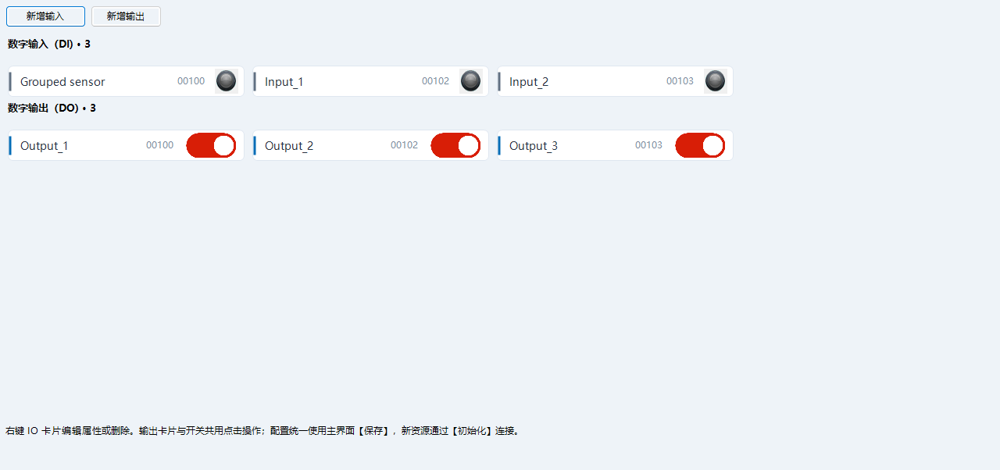

# 组合轴与 IO 资源

## 入口与配置

1. 轴入口为【硬件】，直接显示动态轴选项卡；IO 入口为【手动 → IO 资源】。轴页只显示轴，IO 页只显示输入 / 输出。旧轴示例页面及切换按钮已移除，手动 IO 及输送线页面继续使用。
2. 轴页点击【新增轴】，IO 页点击【新增输入 / 新增输出】，填写名称、厂商和轴号 / 点号。默认自动选择未占用通道及唯一名称，可以直接确认。校验成功后创建一个 NPSDK 组合控件。名称可修改，流程绑定使用稳定 ID。
3. 轴支持双击标题、右键【属性编辑】和工具栏【参数】；IO 直接在卡片上右键【属性编辑】，不再套标题、参数按钮和额外边框。IO 只显示当前驱动实际使用的字段，切换厂商时保留尚未完成的输入。新增仅创建对象，连接通过主界面【初始化】执行。
4. 轴组合提供指令 / 编码器位置、回零、停止、点位表、连续点动和定距离移动。IO 按输入 / 输出分区平铺，每个点一张 40 高的卡片；输入显示状态，输出点击卡片或右侧开关切换。两者复用同一实际控件；手动输出在切换前检查权限、机器空闲和流程租约。PLC 卡片显示实际地址，板卡显示点号。

轴号格式沿用当前已交付 SDK：雷赛一位数字 0–9；凌华三位数字，末位为 0–3。板卡 IO 使用五位数字（前三位卡号、后两位点号）。相同物理通道不能重复添加；雷赛的旧轴号前缀别名和 IO 卡号别名也按实际通道检查。

轴厂商只显示 SDK 已实现的 Adlink、Leadshine。Keyence、Omron 仅用于 IO：Keyence 显示 PLC IP、TCP 端口、软元件类型、数据格式、地址；Omron 显示 PLC IP、CIP 端口、地址；雷赛与凌华 IO 只显示点号和反转有效电平，不显示无效 PLC 参数。现有雷赛驱动没有使用 IP 初始化的实现。

流程对象和组合标题显示原 IO 控件的 Text；内部 Name 与稳定 ID 用于身份定位。修改显示名称不破坏流程引用，也不要求重新连接；已经连接的资源修改驱动参数仍需保存并重启。

## 保存与配方

统一点击主界面【保存】，保存机器设置目录中的 `HardwareResources.xml`，保留前一版 `.bak`。资源名称、ID、轴号、厂商及驱动参数不随产品配方切换。

点位表通过主界面原有【保存】写入当前配方 XML；切换仍由 ProductManagerForm 管理。各轴使用 `AxisPoints_<ID>` 表，包含 Position 和 Annotation。主保存同时提交资源定义和当前配方点位后，下次启动会恢复对应组合控件及点位。

资源增删改未保存时禁止生产启动。已经连接的硬件修改参数后必须保存并重启，避免运行中切换物理通道。文件损坏时拒绝覆盖，应恢复 `.bak` 后重启。重启恢复配置，不自动续跑之前的运动。

编辑窗口【确定】只提交草稿，轴页和 IO 页不再提供独立保存按钮。主保存选择“是”统一提交；选择“否”恢复已保存的资源、点位、常量、生产字段和流程。新配置文件先暂存，再统一替换；失败会保留草稿并恢复已替换文件。当前配方常量或新组合轴点位未保存时，先通过主保存处理，再由 ProductManagerForm 切换。

## 在流程节点中使用

- 轴运动选择页面上的实际轴，点位动作只选该轴已绑定表的行索引及显式偏移；不再另选 Table。托盘计算单独分类。
- 输入输出选择组合中的真实 NP_Input / NP_Output 实例。手动界面与流程共享同一个对象和资源占用检查。
- 参数可绑定 Setting / Recipe 常量或当前型号中的点位参数，结果通过节点输出供其他节点选择。
- 选择初始化入口和自动入口，校验并保存流程工程，退出全部模块的编辑模式，再用主界面已有【初始化 / 启动】运行。模拟模式沿用机器原有 Simulation 设置。

## 右键属性与删除

### IO 分组选项卡

在【手动 → IO 资源】点击【新增选项卡】，输入工位或模块名称。新增页会自动选中；当前页点击【新增输入 / 新增输出】，IO 直接归入该页。已有版本的 IO 自动显示在默认的【IO】页，原有系统、转盘等手动页面保持不变。

页签上右键可新增、重命名或删除；非空页不允许删除，且至少保留一页。需要重新分组时，在 IO 卡片上右键【移动到选项卡】，选择目标页。切页、重命名及移动均复用原来的 IO 实例和流程绑定，不重新连接硬件、不输出信号。

新增、重命名、移动和删除先保留为草稿，统一点击主界面【保存】后生效；主保存选择“否”恢复已保存的页签和 IO 归属。页签属于机器 Setting，切换产品配方不改变分组。页签名称是用户业务数据，语言切换仅刷新按钮、菜单及输入提示。

分组选项卡版本通过 181 项流程回归、54 项离线设计器检查、14 项主界面检查及 17 项统一保存检查，覆盖旧文件迁移、真实按钮和右键菜单、重命名与分组后的实例保留、三语、取消、保存失败回滚、放弃及配方切换。未执行现场 IO 读写；本次未交互打开 VS 源代码设计器。

### 资源及点位

轴组合或 IO 卡片上右键可选【属性编辑】或【删除资源】。目标来自右键命中的组合，与工具栏选择无关。属性窗口【确定】只提交草稿，【取消】不修改资源。点位表区域使用独立的行菜单，右键实际点位行选择【删除点位】。删除点位会改变后续行索引，必须核对流程的点位索引绑定。

流程仍引用该轴、IO 或其点位参数时禁止删除资源；资源被占用、轴正在手动运动、机器运行中或权限不足时也禁止操作。删除后点击主界面【保存】，下次启动不再创建该组合。历史配方中的点位表留存，避免破坏旧配方或备份数据。

流程节点、流程模块页签、常量行、CASE、条件行及生产字段同样使用右键删除。非空流程模块不允许删除，节点和常量的跨流程引用保护继续生效。

## SDK 与验证边界

NPSDK 提供可在 VS 工具箱使用的 `NP_AxisGroup`、`NP_InputGroup`、`NP_OutputGroup`。固定布局位于 Designer.cs；IO 模板只承载实际信号，不再增加可见容器。宿主复用原 IoTileStyle、右键参数窗口、权限、语言桥和持久化。底层登记表使用有效控件快照，释放控件会注销并与后台扫描互斥。

Debug / x64 构建、104 项流程、脚本与资源回归、7 项启动 / 主保存检查和原有 62 项回归通过。覆盖资源保存重载、真实配方切换、实例一致性、引用及占用保护、右键定位、实际新增与确认按钮的完整路径、轴 / IO 页面分离、模拟驱动连续点动释放、延迟初始化、三语编辑值保留和截图检查。独立启动检查使用历史空 MSet，创建实际页面并打开主窗口，未启动硬件和机器线程。未进行现场轴、IO、PLC 联调、不同 DPI 或 VS 交互式设计器实测。

## 轴资源选项卡

轴资源按“一个轴、一个选项卡”展示，标题使用实际轴名称，点位表与操作面板占满当前页。新增轴后自动选中它；轴较多时使用页签栏的翻页按钮。

“参数”按钮编辑当前轴，重复的轴选择下拉框已移除。页签及轴面板均支持右键属性编辑、删除；点位表继续使用独立的行菜单。重命名同步更新页签标题，删除不保留空白页。

页签复用现有轴、驱动、点位表及资源 ID。切换页面或语言不会重建对象、清空点位草稿或触发运动。配置仍通过主界面“保存”，点位仍由 ProductManagerForm 配方切换；IO 布局保持独立。

离线验证覆盖三语、三种窗口尺寸、原实例/点位行保持、右键命中、增删改、放弃、保存重载，以及主保存的取消/失败恢复。真实轴运动与 VS 交互式设计器未实测。

本版验证：178/178 流程回归、22/22 设计器兼容检查、64/64 视觉及全页面语言检查通过；主保存、放弃、失败回滚与重载检查通过。

## ManualControl 的动态轴列表

【硬件】页面在【新增轴】上方固定提供一个【手动调试】按钮，使用 `NP_ManualControl`，`WorkMotor` 保持空。无需动态新增调试控件，也不用在“原有轴页面 / 轴资源”之间切换。每次点击时，SDK 从所属窗体递归遍历真实 `NP_Motor` 控件，包含 Panel、未选中的 TabPage 以及 `NP_AxisGroup.Motor`；因此动态新增的轴会直接出现在调试窗口中，无须另外维护轴列表。

列表显示轴的当前 `Text`，操作复用同一个轴对象。新增、重命名或删除后重新打开窗口即可刷新；已经移出页面的控件与其他窗体的轴不参与本次遍历。如果设置了 `WorkMotor`，窗口仍只显示指定轴。

遍历和打开窗口不执行轴初始化、回零或移动。轴定义仍通过主界面保存，轴点位继续由 ProductManagerForm 切换配方。设计时点击不打开运行期调试窗口。

旧 X1 示例轴、回零、点动、位置显示控件及其专用图像、定时器不再创建。历史非可视配置表结构继续保留，避免主保存破坏旧配方数据；它们不会创建旧轴实例，也不会出现在全轴调试列表中。固定调试按钮的标题随中文、英文、西班牙文切换。

本次验证：179/179 流程回归、54/54 设计器兼容检查、14/14 主界面检查及 17 项统一保存检查通过；已在 VS 中重新打开 HardForm 设计器，确认固定入口和运行布局一致。实际点击 SDK 调试按钮验证隐藏页签中的轴、删除与重命名后的列表，以及三语切换时点位草稿保留。验证未执行实际轴运动。
