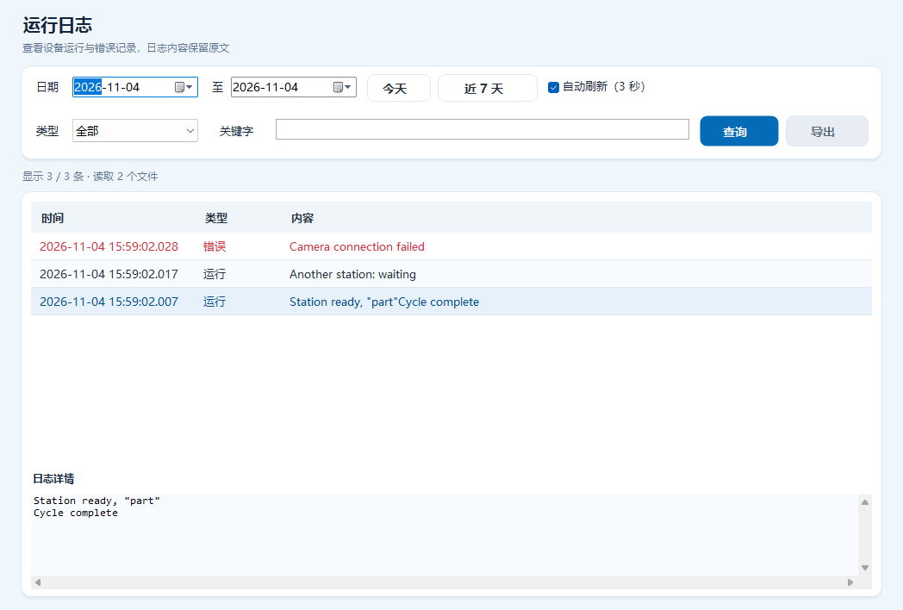

# 运行日志模块

左侧“系统”分组的“运行日志”打开独立查询页。页面沿用 DataForm 的 `LogRun` 和 `LogError` 实例配置的实际写盘目录，默认分别为 `D:\Log\LogRun` 和 `D:\Log\LogError`。

支持日期范围、运行/错误类型和不区分大小写的内容关键字筛选；“今天”和“近 7 天”可快速查询。结果按时间倒序，选择一行可在下方查看和复制完整原文，包括引号、逗号与换行。

自动刷新默认开启，间隔为 3 秒。页面隐藏时停止刷新并取消后台查询；修改筛选条件时取消旧查询，点击查询后才使用新条件。语言切换保留筛选输入、记录对象和选中详情，只修改可见标题和类型显示。

查询日期最多为 366 天。最多显示最新 10000 条，同时显示全部匹配数量；数量超限、日志读取失败或记录格式无效都会在状态行提示。导出使用点击时的当前结果快照，CSV 列键为 `Time,Level,Content`，使用 UTF-8 BOM。

运行日志是机器级历史，配方切换保留记录。页面只读，没有新增配置持久化入口；现有日志模块的目录配置、草稿保存和放弃修改继续使用 MainForm Save。



## 验证

```powershell
./tests/RuntimeLogs/Run.ps1 -AssemblyDirectory 'AlphaRap/bin/x64/Debug'
./tests/MainDashboard/Run.ps1 -AssemblyDirectory 'AlphaRap/bin/x64/Debug'
```

日志回归覆盖实际 DataSave 写盘与查询、类型和关键字筛选、日期边界、同毫秒重复记录、最新记录上限、取消任务、无效日志格式和 CSV 导出；另检查两种页面尺寸的三语布局、语言切换的数据保护、实际后台查询及隐藏页面停止刷新。主界面回归检查新增入口及返回首页，并保留原设备操作事件验证。以上均为离线验证，不执行机器 Load、运动、IO 输出或相机采集。
